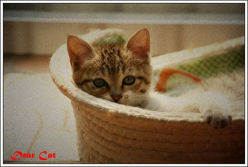
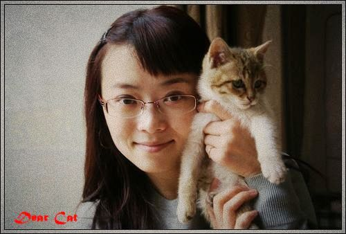
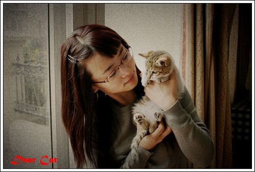
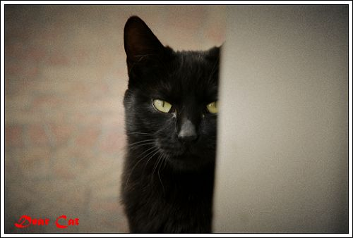
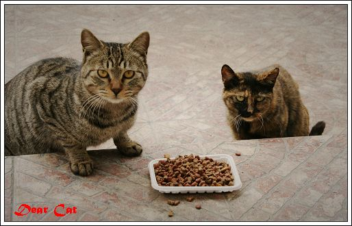
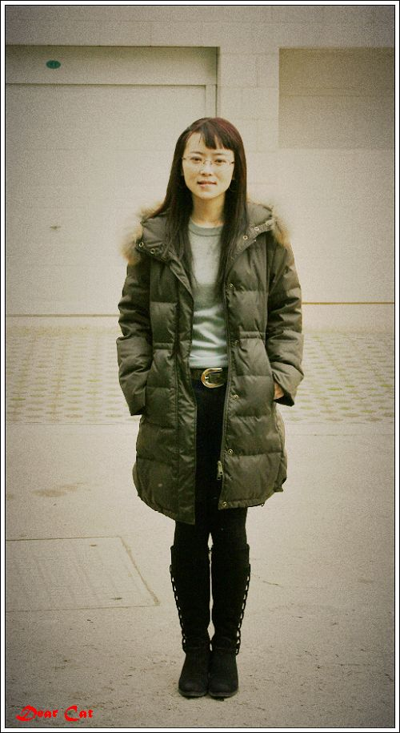

# Dear Cat

这是一只流浪猫，发现它的时候它趴在自动洗车房外面的积水里，声嘶力竭地喵喵叫，比现在的体型小很多，可能还未断奶呢。  
  
听洗车工说，一早有辆别克车来洗车，听见引擎盖下面有猫叫，打开一看里面两只小猫，可能冬天寒冷，小猫藏在引擎盖里面睡觉，结果被带到另一个地方了。两只小猫刚被放在地面上，其中一只就被汽车压死了。。。  
  
剩下的这只被我带回来，洗过两次澡才把他身上的虱子洗干净。每每碰它，它就会叫，声音象是皮球被挤过的声音，所以给它取名“皮球”。小家伙非常调皮，喜欢粘人，是一只擅长交流的猫咪，有时挺烦人的，就象话多的人一样令人厌烦。睡觉的时候总喜欢钻到你的怀里，很会享受的家伙。  
  
   
   
   
  
它是一只流浪猫妈妈生的黑色的猫MM，同一窝有6只BABE，最后剩下两只，一公一母，成年了还没有离开自己的母亲。这只黑猫性格内向，胆子小。母亲后来又生了一窝小猫，猫MM就帮着妈妈照顾弟弟妹妹，很有意思。每只猫咪的性格都不一样，和我们人类是一回事。  
   
  
右边的就是英雄母亲：猫妈妈，左边的是猫MM的哥哥肥头大耳的狸花猫，狸花猫有时会消失几天，每次来就是吃。我们可是看着猫MM和猫GG长成这么大个儿的。现在每天除了喂它们猫粮，有时还会喂些小毛鱼改善伙食。现在猫妈妈又养育了三只小BABE，这个家族越来越壮大了，赶明儿会不会变成母系社会？呵呵~小小猫长大后会不会还留在妈妈身边呢？  
  
有一次它们母子三个捞了一条足有5、6斤重的鳊鱼，阿姨把生鱼从它们嘴里抢出来切成几段，用微波炉烧熟了分几次喂它们吃，猫妈妈第一次看到被分割的鱼时，表情惊讶楞了好一会儿，估计头上冒出的泡泡是：“咦，这鱼怎么变这么小了？”  
  
  
不同服装下的我...而已。  

---

## 评论（9）

**sunshine** · 2008-01-07

第二张图片中女主角的发型和表情很可爱！  
看来还很年轻呢，就快变妖精了吧。  
这人难道不会老的吗？

**[Sophie](http://www.flickr.com/photos/morena7)** · 2008-01-07

1. 可爱的猫咪  
2. 可爱的Christina  
3. 可爱的发卡  
4. 可爱的表情-抿嘴

**lionhead** · 2008-01-07

以为最后一张也是只猫，一看这么大个！：）

**灰子** · 2008-01-07

好可爱～

**[afan](http://blog.wenxuecity.com/myblog.php?blogID=22490)** · 2008-01-09

猫妈妈老了  
建议:   
1. 养猫最好出于猫道主义阉割;  
2. 不要用小动物做礼物, 如果接受者不喜欢, 对小动物的命运不公平

**大姜炖去** · 2008-01-10

有没有打过针?献爱心的时候也得保护自己和家里人,呵呵

**Christina** · 2008-01-11

没打针，去过政府办的宠物医院问过，人家没有给猫的疫苗。只有私人医院有。已经养了一个多月了，皮球长大了不少。我把它嘴扒开看，里面的牙齿已经开始冒出来了。

**大姜炖去** · 2008-01-11

其实小狗小猫牙齿上的携带病毒可能比长大了更多,如果上窜下跳疯疯癫癫的,就应该给它打一针,以绝后患......  
多给它洗洗爪子,有一种猫抓病,  
算了,不吓唬你了,呵呵  
小猫还是挺可爱的

**[talkybird](http://www.daydream.com.cn)** · 2008-01-13

猫猫们三个月大之后最好还是去打个猫三联，一年一次。安全第一。为了猫猫，也为了你自己。如果是散养的话，绝育手术也是必要的哦

