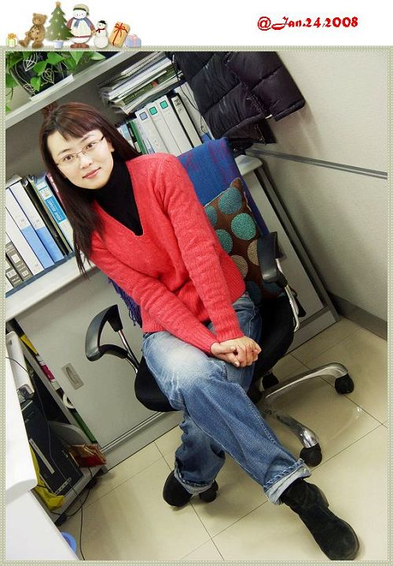

# 这不是Bravia的红:)

---

## 评论（11）

**苏小小** · 2008-01-24

蛮漂亮的，就是发型不好看。

**okdata** · 2008-01-24

Nothing can not be comparable with the nature:) So the BRAVIA is. But I do prefer panasonic plasma.

**okdata** · 2008-01-24

That is a weird world.

**[einsure](http://simplenice.wordpress.com.cn)** · 2008-01-24

看你这张照片的时候很自然的会把头侧过来看，呵呵，一直好奇你的那些照片都是谁帮你拍的？

**Christina** · 2008-01-24

好些都是自拍的呀~就是找不到帮我拍好照片的人~

**[abdalla](http://hi.baidu.com/hifey)** · 2008-01-24

自拍?  
其实还是不错的。

**[einsure](http://simplenice.wordpress.com.cn)** · 2008-01-25

“好些都是自拍的呀~就是找不到帮我拍好照片的人~”  
呵，我认识一个朋友（女）是搞摄影的，经常为模特拍照的，你若有兴趣找她给你拍喽，不过她在上海的

**[七月儿](http://cathyjuly.blogcn.com)** · 2008-01-25

Tea的皮肤好白皙细嫩，怎样保养的呢？分享一下呵

**Christina** · 2008-01-26

用玉兰油和姿生堂，以前用过LANCOME、CD和CHANNEL，仅此而已。不去美容院做美容，爱吃肉，水果和蔬菜也没刻意计划去吃。健身停了三四年。

应该健身比美容更有益吧，促进血液循环，调节心情。还有保持好奇心和童心也有助于心理健康吧，别的没什么总结。还真没刻意去保养过什么，怎么舒服怎么来吧~

**EDWARD** · 2008-01-29

今年二十，明年十八！ 呵呵

**大姜炖去** · 2008-01-29

期待你的11小时的游记,南京到上海用了这么长时间,估计够爬一次珠穆朗玛峰了

