# 那是相当地越野！

昨天从上海开车回南京，11个小时到家，越到苏南雪越大。  
4WD派上用场了，相当的越野~对于我是一次宝贵的驾驶经验。  
  
27号下午两点告别朋友，向312国道出发。  
时速8公里在曹安路上龟行了两小时才出城，  
按这个速度我们要到第二天下午2、3点才能到南京。  
  
上海出来往太仓方向开，疾雪，但车不多，这是幸运的。  
不幸的是来去道路中间即使隔着栅栏，仍然时不时冒出一辆逆行的当地车，我们在车上是又惊又气。接下来的路线是：常熟--张家港--江阴--常州--镇江--上312国道--宁镇公路--南京。路上居然有山东牌照的QQ车在马不停蹄的赶路，看到这情形，我们顿时信心十足，QQ都这么牛，我们到南京肯定不成问题了。说是这样，驾驶仍然很小心谨慎。  
  
这种路况下总结出经验是：  
缓加速；  
缓刹车；  
缓打方向；  
颠簸时握紧方向盘；  
保证油箱处于满油。（一路上我加了三次油，一次100元，两次50元，不知道后面会遇到什么情况，有油就不怕~）  
准备充分的话要检查机油、冷却液、蓄电池电解液是否适量。  
  
虽然神经紧张但特兴奋，那感觉是相当地越野。  
多亏了我的爱车，路上狠狠得亲了方向盘一下。  
还有GPS，没它我肯定会迷路，当然对于GPS的信息有时需要结合当时的情况，不能一味依赖。  
四轮驱动模式下，长途下来每百公里耗12个油，不错的表现。  
  
路上遇到一辆宝马530，前轮打左拐，后轮直行，我们跟在后面，开始以为宝马的前轮坏了，看了会才明白人家是想从积雪的压痕里拐到左边的道上，怎么也翻不过那道小雪坡，就那么一直开着。哈哈~~从宝马旁边开过去的时候，那驾驶员绝望地望着我们绝尘而去。  
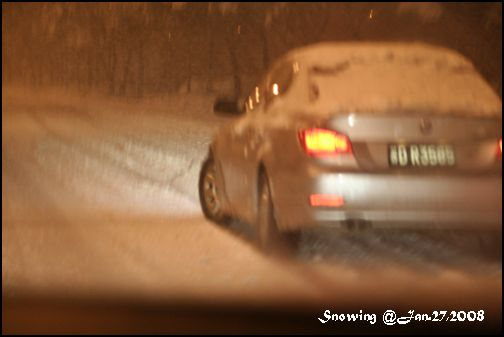   
  
倾斜在路中央的集装箱车  
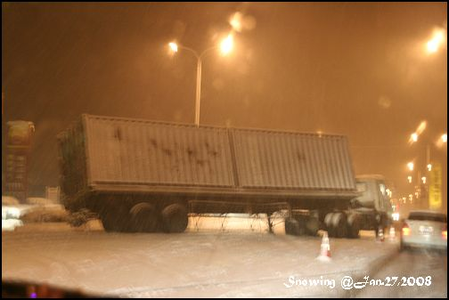   
  
听说312国道堵车十几个小时，不论这消息是否确切，我们决定从沿江公路走，这是338省道。路上车不是很多，有时一条笔直的马路只有我们一辆车行驶在冰天雪地上。  
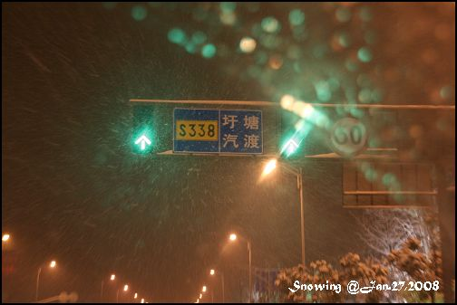  
  
如果没有GPS导航，估计我们会在雪地里过夜了。   
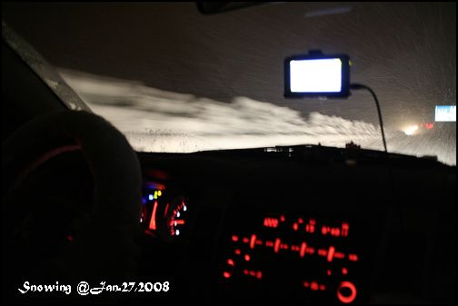   
  
到常州的时候我们询问当地驾驶员镇江怎么走，人家调侃地回答道：“三天以后才能到镇江。”小看我们的能力了。  
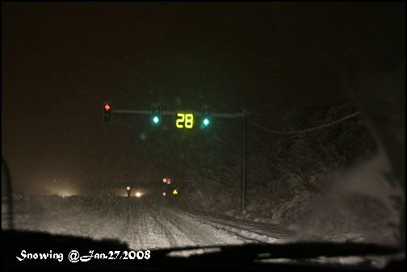   
  
哦也~312国道南京收费站到了，胜利在望！  
那时是夜里12点40几分。  
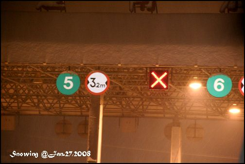   
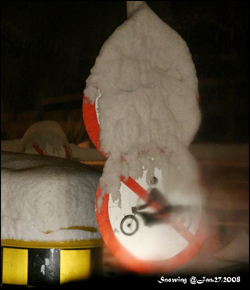   
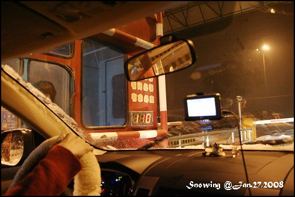   
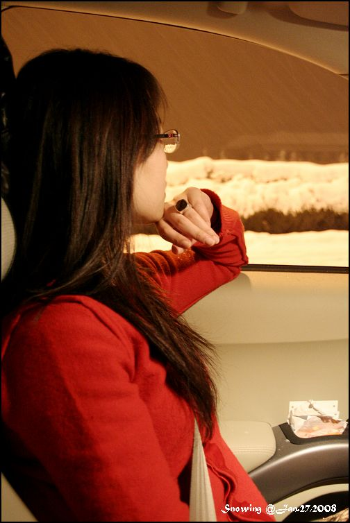   
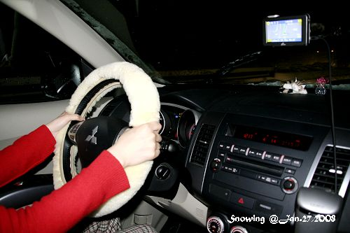   
  
归归~南京的雪还真的大哦~漂亮~   
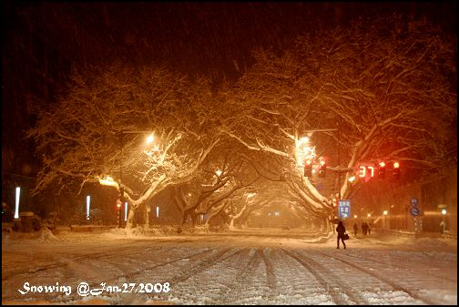   
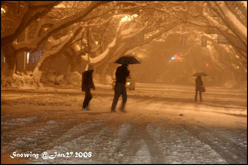   
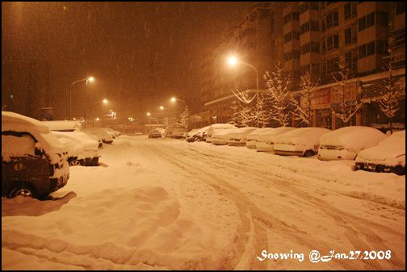  
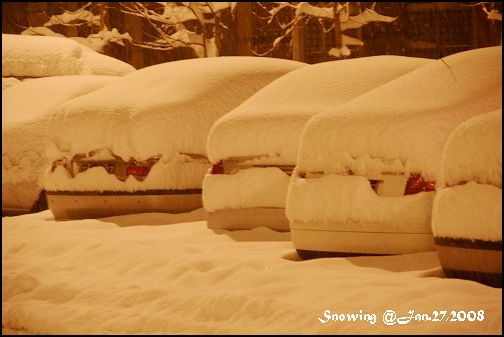   
  
来一张26号在车内拍的PP~那时还在上海呢！  
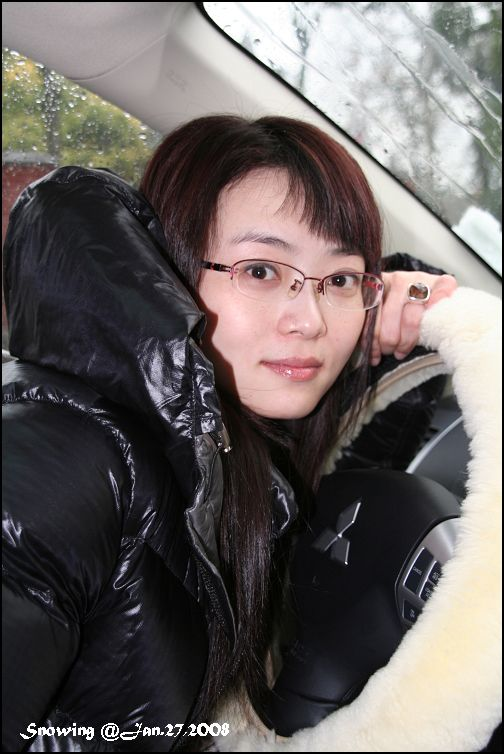

---

## 评论（4）

**jia** · 2008-01-29

that’s a very precious experience, unforgettable  
memory….. 感谢毛主席;感谢gps,感谢小欧, 当然还有你:)

**[阿帆](http://blog.wenxuecity.com/myblog.php?blogID=22490)** · 2008-01-30

哇，真是雪灾  
前几天不是还报道暖冬来着

**okdata** · 2008-01-31

A good choice, the EX just for you.

**james** · 2008-01-31

无语了，只能说我真的崇拜你特立独行的气质！

