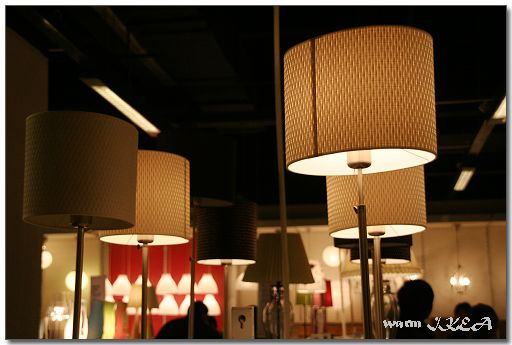
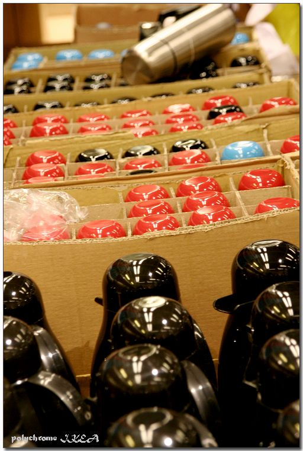
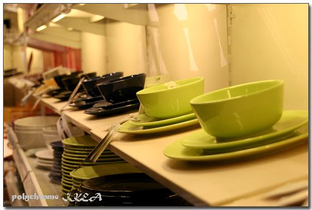
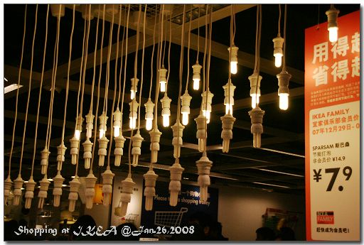
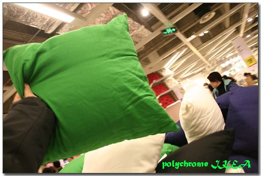
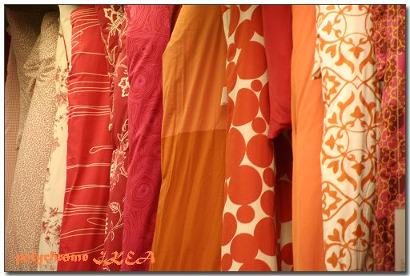
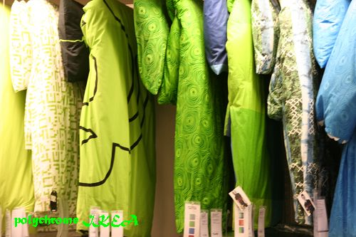
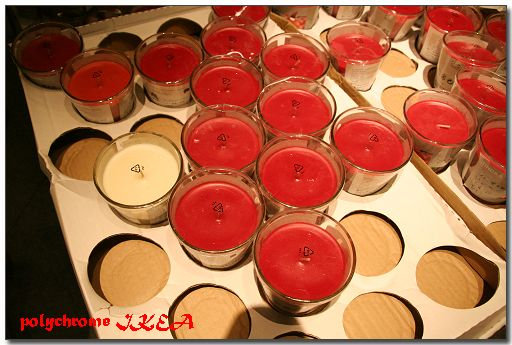
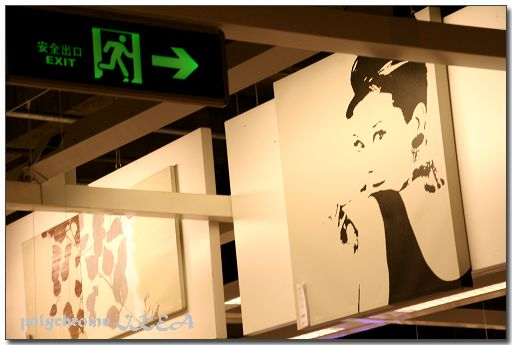
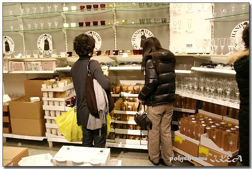

# polychrome IKEA

   
   
   
   
   
   
   
   
  
  
  
   
   
   
  

---

## 评论（6）

**淡蓝色** · 2008-01-30

你朋友的新发型真精神！！你们的皮肤都很好！

**Christina** · 2008-01-30

你到江南来生活，皮肤也会好的，嘿嘿~~

**huntun** · 2008-01-30

嘿嘿,最后一张很卡通可爱,你买的是地毯还是...?

**Christina** · 2008-01-30

一条印度产的毛线毯~~

**Blue Simon** · 2008-01-30

最后一张不错，哈哈

**okdata** · 2008-01-31

Ha, ha, two nice ladies show their real life:) Looks like your guys had a long sleepless night.  
The IKEA is a good place for spending money, just for you:)

