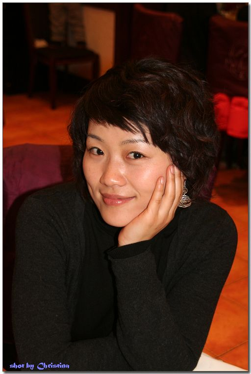
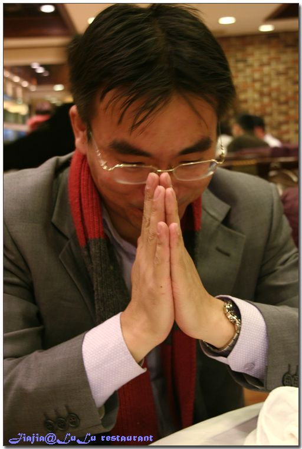
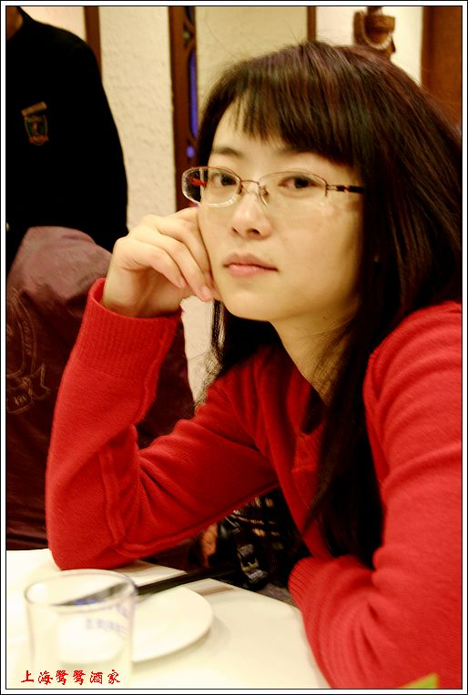

# 鹭鹭酒家 since 1985

用了闪光灯，这种PP的效果好一些，一点不用编辑，直接加了相框上传上来；  
   
  
下面是没用闪光灯的，自动白平衡模式，PP仍然需要编辑。  
  
   
   

---

## 评论（4）

**okdata** · 2008-01-31

The nature is the best. A good photographer always shows the best taste with simple method.

**雯子** · 2008-01-31

鹭鹭的菜一般啦。大厅人多暴吵。不过地段好。所以生意很好。位子蛮难定的，特备是包房。在博上看到你来上海爱去鹭鹭吃饭呢。呵呵。下次来上海去吃醉美川菜嘛，靠近时代广场淮海中路上的。川菜做的蛮地道的。记得通知我哦。

**中国茶粉丝杭州站站长** · 2008-01-31

添加杂点，其实不用太多。

**elsa** · 2008-02-07

题头图真美  
好象油画！  
新春快乐~~

