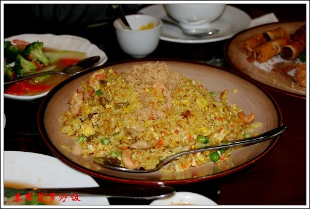
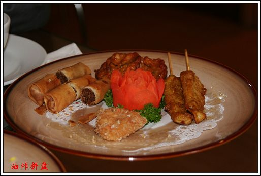
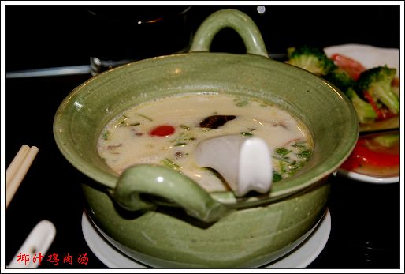
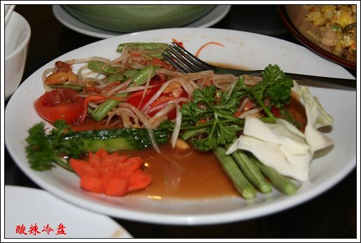

# 好吃的泰国菜

   
   
   

---

## 评论（7）

**大姜炖去** · 2008-01-30

这个豆角怎么像是生的?  
那个油炸拼盘还有菠萝炒饭对我有吸引力  
西兰花是什么菜啊

**Christina** · 2008-01-31

冷盘里的菜都是生滴~~  
西兰花是生的~

**大姜炖去** · 2008-01-31

生豆角我是坚决不吃的,有过惨痛的经历  
曾经在冬天吃豆角,因为没有笊熟,食物中毒,吃得我上吐下泻,  
至今吃它都心悸,一朝被蛇咬,十年怕井绳

**mandy** · 2008-01-31

哪家泰国菜？第一张炒饭让我想起我最喜欢的上海葡京茶餐厅的澳门炒饭。喜欢！

**zyz** · 2008-02-01

西康路武定路“泰国家”

**Blue_Simon** · 2008-02-01

上海的泰国菜比较好吃的我觉得是正大的金象苑和富民路的Coconut Paradise

**车安真** · 2008-02-08

菠萝炒饭看上去真好吃 你去的难道是泰煌么  
新照片拍的你很美哈

