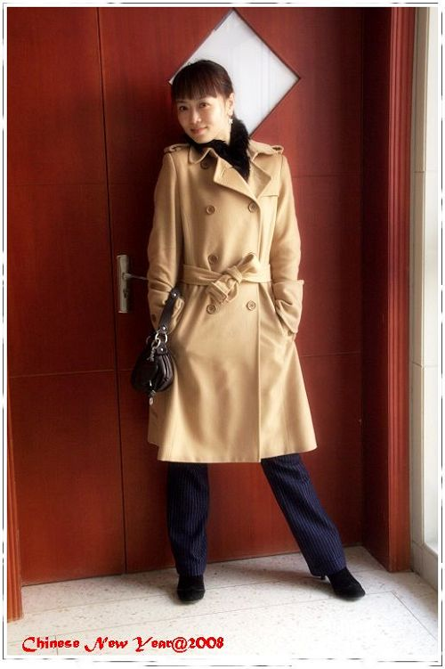
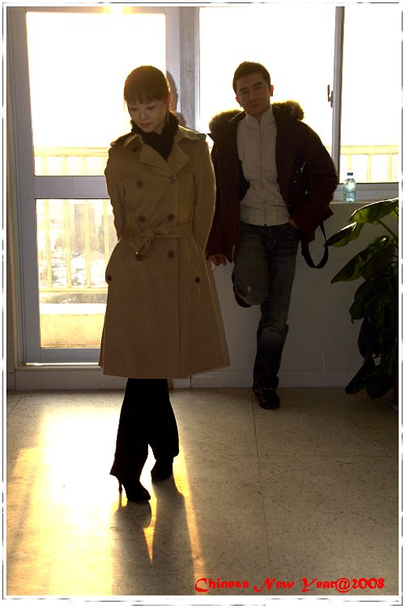
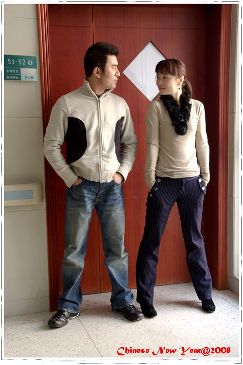
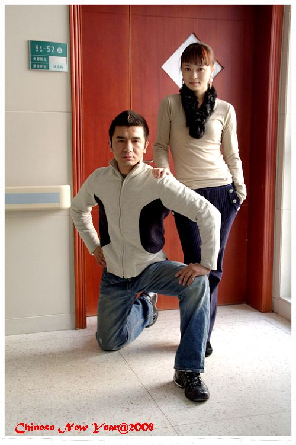
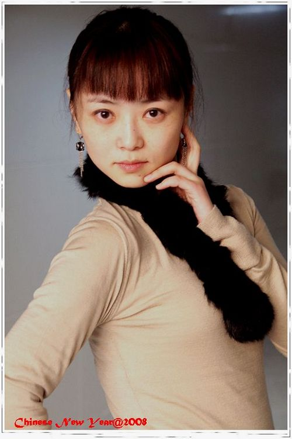
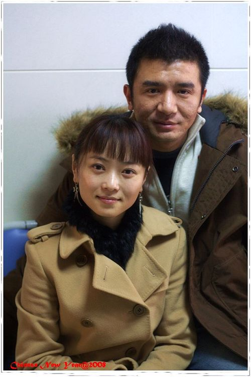
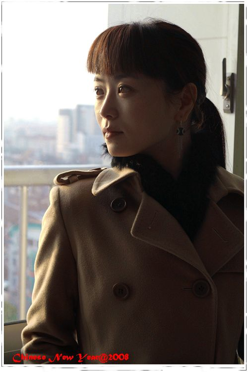
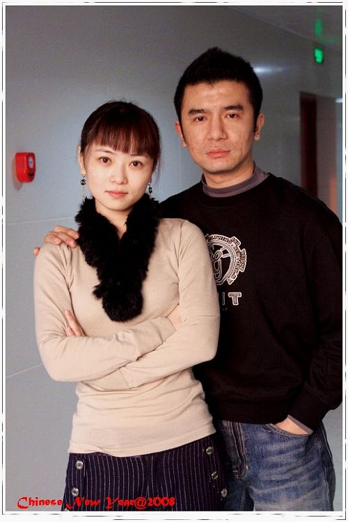

# 春节.探班

春节去剧组探班，朋友作为中央电视台和江苏省电视台合作的20集电视连续剧《龙脉》的制片方及电视剧中男7号，春节仅放了两天假，他便没有回北京，初七去看他，因为同步录音，医院走廊上静悄悄，原来拍电视剧是这样的，原来剧照是这样拍成的，呵呵~~  
   
   
   
   
   
   
   

---

## 评论（30）

**zyz** · 2008-02-14

女一号，情人节快乐：）

**EDWARD** · 2008-02-14

Christine, 你不做演员太可惜！  
PS: 男演员不咋滴！

**Christina** · 2008-02-14

他本来就不是演员,呵呵~~因为他属于制片方的人,所以弄了个角色玩玩的，以前他是学舞蹈的.

**[一斤蓝色](http://hi.baidu.com/oneblue)** · 2008-02-14

男人五官不错,就是脸上太黄土高坡,如果是近看,可能还更恐怖些,不过也无妨,男人的外表和才华成反比嘛^^

**[一斤蓝色](http://hi.baidu.com/oneblue)** · 2008-02-14

情人节快乐！

**大姜炖去** · 2008-02-14

男7号是不是新疆人，和我同学很像  
想起迪克牛仔的一首歌  
如果你是爱上我的沧桑

**[灰子](http://yaohui.blogbus.com)** · 2008-02-15

呵呵，好玩，有意思～1234张中的你好美

**[青花碎瓷](http://blog.sina.com.cn/chinatea)** · 2008-02-15

呵呵  
你的表情很有意思  
呵呵

**Christina** · 2008-02-15

男7号是北京人~  
太沧桑的男人估计不是一般女孩能爱得上的~

Chinese Tea就必须是关于茶叶茶水茶文化的么？呵呵~~有上过花茶的一张图片，如果偶尔来看看，估计会错过滴~有关Chinese Tea的由来，建博初期有过一小段文字，可以找来看看的。

谢谢茶友多年来的关注，大家2008年安康、快乐~

**777** · 2008-02-15

你看这个男的不难受，脸上那么多疙瘩。

**Christina** · 2008-02-15

不对，不是疙瘩，是火山坑~  
象亲人一样的朋友，小时侯生活在一起好几年，人家青少年时期皮肤很好的，好多年没见，不知道怎么变成沧桑型的了？！  
对于朋友的外貌没要求的，人善良就好了~~

**淡蓝色** · 2008-02-15

这件大衣很好看，什么牌子可以告诉我吗？

**Christina** · 2008-02-15

paul smith~

**[quinn](http://simplinice.wordpress.com.cn)** · 2008-02-15

不知为何，看你的这几张照片时觉得比年前的你憔悴了些，不会过年过的吧，还是因为身边的那个男人的关系？

**淡蓝色** · 2008-02-15

楼上的这位是来搞笑的吧？  
怪不得这件很好看，原来是大牌~~  
很适合你的！

**Ma Duddell** · 2008-02-15

看你博有些日子了，总看不到你的那一位，何也？

**Christina** · 2008-02-15

quinn真是关心我关心到骨髓里了~~犯晕~  
憔悴是为了配合一下人家脸上的沧桑,呵呵~节日期间通常睡的比较晚,憔悴点有感觉呀,要不您也试试~~

Ma Duddell想见另一位,等他建博了一定转告你~~

**土豆沙发的剧照** · 2008-02-15

照片虽好但不知出于那位“大师”拍的，至于博友说那位男孩子，是为了承托MM的柔吧，不然她摆造型不会那么投入啦！

**艾伟桉** · 2008-02-15

“神龙见首不见尾”以后我不跟您照相了,老挨骂

**艾** · 2008-02-16

你咋从小到大老让善良的人们产生嫉妒的天性呢，跟你照相老遭到不客观的评价，他们看你的角度往优点看，看我的角度是往缺点看。我一定要学会自嘲和低调，我们的口号：默默的吸引别人的眼球，因为眼球里有整个世界！

**okdata** · 2008-02-17

楼上的哥们要挺住，你脸上的积淀和难掩的内涵不是所有的孩子都能一下子发现的。  
自嘲和低调是不够的，我们提倡“死猪”精神:) 当然，秦淮河边陶冶情操就免了吧:) 下次感冒不要板蓝根了，记得喝水、扑痛，加桑拿。

**爱旅游的人** · 2008-02-17

你可以演反派人物，要不去整容，火山坑应该比较好去掉。

**zyz** · 2008-02-18

那些对别人长相评头论足说三道四的，不知道是不是自己更寒碜来寻求心理平衡。。。我觉得挺好，挺MAN， 不知道是不是你们奶油小生看习惯了，该疲劳一下了

**chenwei** · 2008-02-19

天哪，我怎么觉得有夫妻相啊？难道只有我一个人这么觉得！！

**Christina** · 2008-02-20

楼上的太有才了，谢谢您~~  
所谓夫妻相光长得象有什么用？真是太佩服您的眼神了~  
俺们就是青少年时期生活学习在一块的伙伴，虎子也是，10多年没见，跟亲人一样。就这么单纯的感情。

**emmaemma** · 2008-02-22

我也对大衣感兴趣…… paul smith在上海有店？是在上海买的吗？

**Christina** · 2008-02-22

emmaemma在美国买不是更方便?  
南京都有了,别说上海了.

**Ma Duddell** · 2008-02-22

不好意思！请问美国怎么走？呵呵

**okdata** · 2008-02-24

嗨, 和谐社会, 要尊老爱幼, 尊老爱幼.....

**sarah** · 2008-03-27

你俩挺有夫妻相的。

