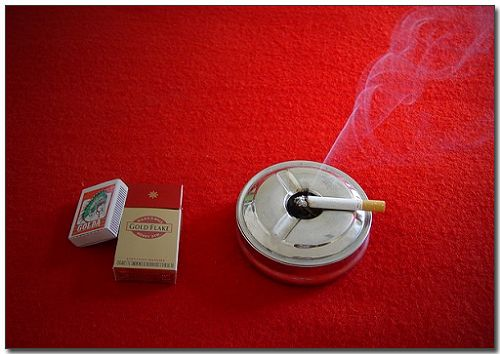

# 留恋

  
  
2月21日0点刚过，便听见外面噼里啪啦的鞭炮声，一直到21日晚上12点鞭炮声仍然不绝于耳。此前节日从我的感觉里消失了。  
  
元宵节晚上12点，打电话向女友诉说对于这个节日忽然迸发出些许留恋，留恋鞭炮声，留恋夜空中璀璨的烟花，留恋逝去的春节，留恋着留恋...究竟留恋什么，自己也不知道。

---

## 评论（8）

**zyz** · 2008-02-22

甩一甩头，不留恋一丝一缕，因为那只是忧愁。

**Ivy** · 2008-02-22

我留恋小时候的那种盼望和期待过年的心情，以及和家人一起的热闹。现在，都淡了很多。再也没有那种兴奋劲了。留恋那些美好的记忆啊。

**Ma Duddell** · 2008-02-22

我分不清留恋跟怀旧的关系，但总觉跟逝去的岁月和经历的沧桑有点瓜葛，人生易老天难老，毕竟又长一岁啊.

**大姜炖去** · 2008-02-23

我在留恋，  
留恋父亲的黑发，  
母亲的面容，  
还有逝去的人们  
以及蹉跎的光阴

**[青花碎瓷](http://blog.sina.com.cn/chinatea)** · 2008-02-23

对着时间人的无奈和胆怯是有的  
不过科技要是取得大突破  
呵呵  
就可以留住时间了  
老活在18岁  
呵呵  
想想都美

**okdata** · 2008-02-24

留恋, 抑或 怀念? 说不清. 很想回到小学时和家人围着桌子吃饭的无忧日子. 可惜只能回忆了. 不过明天的太阳总是新的, 哪怕隔着云彩:)

**[abdalla](http://hi.baidu.com/hifey)** · 2008-02-24

留恋着留恋吧。

**[quinn](http://simplinice.wordpress.com.cn)** · 2008-02-25

元霄节的晚上被烟花爆竹吵得受不了，没想到上海竟会如此放纵烟花爆竹，虽然看到了不少漂亮得焰火，但还是喜欢静一点好，那天晚上我的电影都没看好

