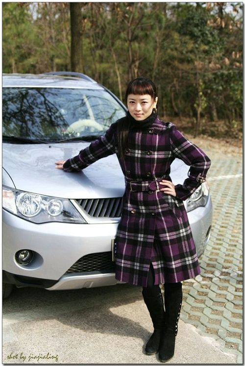

# shot by jiajialing

[more pix here...](http://photo.lifetea.org/v/Its+me/080224/?g2_highlightId=6750)  

---

## 评论（5）

**[quinn](http://simplinice.wordpress.com.cn)** · 2008-02-25

给你拍照的朋友玩摄影多久了？

**Christina** · 2008-02-25

我认识他5年了，都是业余爱好！  
这是我的相机拍的，还有一部分是在他的相机里，还没看到。

**[绿恐龙](http://www.dlog.cn/dinosaur)** · 2008-02-25

这个发型美了很多，貌似很喜欢去四方城拍照，四方城建议还是少去，那块地方阴气特别特别重。

**wahaha** · 2008-02-26

四方城阴气重好呀,可以采阴补阳啊。

**Michael** · 2008-02-26

要是人再向边上站一点,把漂亮的中网露出来就好了:)

