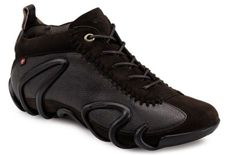

# 裤装春天

除了今天，这周的阳光都极好，每每行驶在阳光里都会莫名的冲动，想要享受一整天的阳光不去上班。春天的阳光却让我热衷于裤装和便鞋，晚上可以花一两个小时找一条N年前穿的全棉宽腿裤和灯笼裤，只为配上刚买的这双ecco鞋，走在春天的路上无比轻快，好似回归~  

---

## 评论（1）

**爱旅游的人** · 2008-03-06

我觉得你上班很长时间了，应该出去进修和学习一段时间，我最近也在准备申请一个ONLINE 的学位，每年只要去CAMPUS两次，等拿到学位，就可以PROMOTION。

