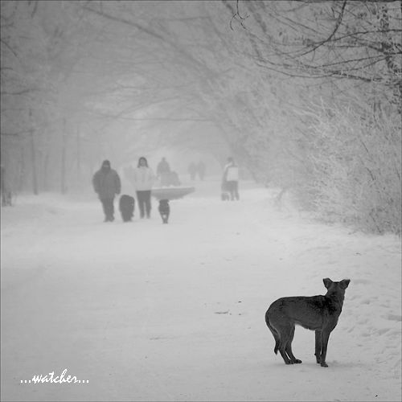

# 三十人生

搭god的车到公司，9：03。  
比自己平时到公司要早。  
在办公桌前坐下来，想起我们几个人god,jiajialing,Angie...的现状...  
感伤，扰乱长久的平静，或者那不是平静，而应该是麻木...  
人生其实不是二十几岁那样的，现实的人生应该是现在这样的。  

---

## 评论（8）

**[yaotian](http://www.xiongcaocao.com)** · 2008-03-07

有点凄凉？为何如此感伤？

**爱旅游的人** · 2008-03-07

你们是不是丁克族，就是不要孩子家庭，自己玩，有很多同性和异性伴侣。

**[青花碎瓷](http://blog.sina.com.cn/chinatea)** · 2008-03-08

人不能控制的东西太多了  
情绪是其中之一  
享受物质的同时  
人需要精神的表达和喧嚣  
想对你说  
喝茶去吧

**jjsuperjj** · 2008-03-08

I guess by now you’ve lived long enough to know that life is indeed full of disappointments.

Yes, Life Sucks. What’re you gonna do about it?

**Annie** · 2008-03-08

Life is life. How can we define it? All I know is Life’s too short. Just do whatever u want

**阳光小虫** · 2008-03-08

其实还好，人总会有几天很伤感！

**okdata** · 2008-03-09

还好啦。看看奔五十的人，多幸福啊。   
革命生活苦啊，要善待自己：）

**alexli** · 2008-03-10

记得有位朋友这样跟我说:结婚就是一时冲动，你太冷静，所以。。。。。

