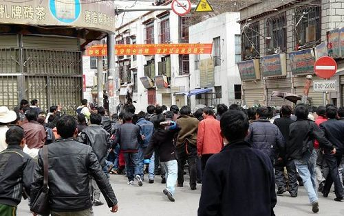
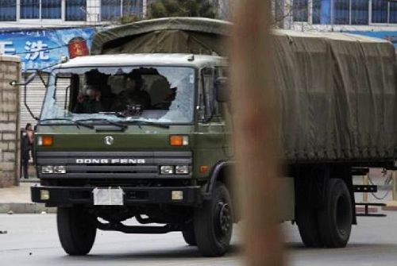
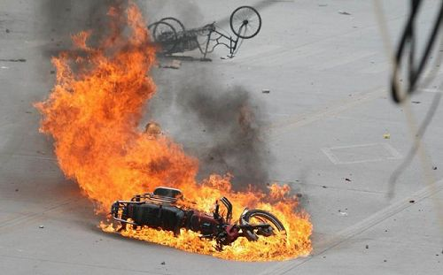
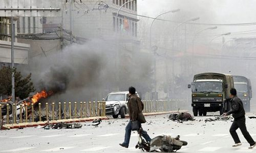
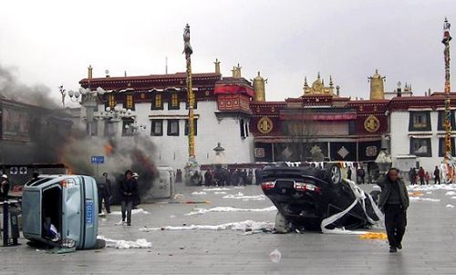
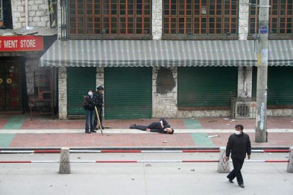
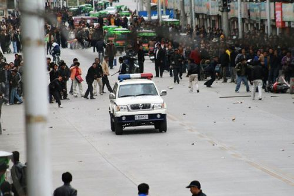
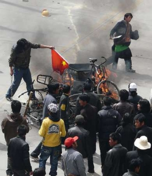
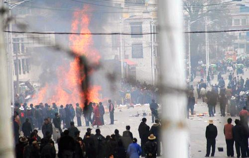
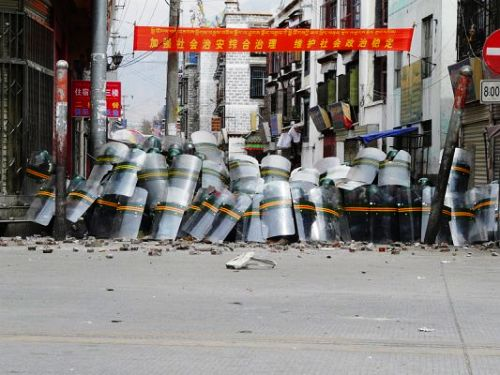

# 多事之秋

昨天晚上，看到CCTV 4 循环播放了两遍 [“拉萨3月14日打砸抢烧暴乱纪实片”](http://www.dingtv.com/v/view_video.php?viewkey=f98819caf142a417dc00)，  
早晨醒来仍然心有余悸。国家政府不容易啊，社会团结稳定，国泰民安是我们民众应该拥护的！  
  
5月的西藏之行搁浅了~  
  
   
   
   
   
   
   
   
   
   

---

## 评论（6）

**nick** · 2008-03-21

恩, 有点觉悟了……

**[quinn](http://simplinice.wordpress.com.cn)** · 2008-03-21

有段时间没来逛了，新的图片很漂亮  
说到西藏，就想起曾经差点去了哪里做志愿者，唉，如果去了，现在还回不来呢  
前几天在网上输入西藏时都显示不出来，国家啊！！

**叫兽** · 2008-03-21

加强联系,学习藏文!促进共处!

你好 扎西德勒  
谢谢 突及其  
对不起 贡达  
好的，没问题 那翁  
再见（自己留下） 卡里飞  
再见（自己离开） 卡里秀  
你叫什么名字？ 名卡热  
我的名字是… 额阿名纳  
你从哪里来？ 卡内沛巴  
我明白 哈古松  
我不明白 哈古吗松  
你明白吗？ 哈古松厄  
好汉饶命 —- 乌哈嘟里

你要杂子 拉空卡巴  
你娃是不是想挨打 冬西丙恰恰尼勒  
信不信老子甩你两把火药枪 嘟鲁阿舌其恰朗克  
给老子滚开 西可西可

你娃有本事等到起,老子马上喊兄弟伙来弄你  
冬西丙撒撒卡拉,翁西洒背突突  
记住关键的最后一句!!必要的时候可以用

**okdata** · 2008-03-21

好孩子

**[青花碎瓷](http://blog.sina.com.cn/chinatea)** · 2008-03-22

看了你那么久文章  
原以为你是个只管自己内心而不装世事的小女人  
没想到关键时刻还能说出这么贴心的小话  
嘿嘿  
表扬一下

**J.H.** · 2008-03-23

可以穿着藏袍照样去

