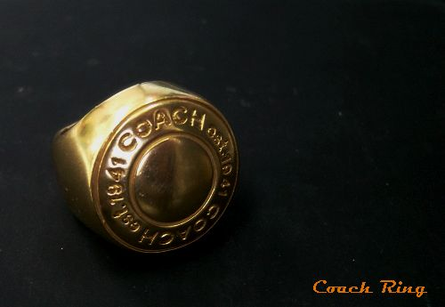

# 无题

---

## 评论（5）

**mandy** · 2008-03-28

不好意思，我眼拙，是什么呀？

**叫兽** · 2008-03-28

coach是好包，这玩意是哪个包上拆下来的？

**Christina** · 2008-03-28

这是一戒指,老大~~

**okdata** · 2008-03-28

戴着它，开小切，在Yael Naim – New Soul中徜徉夕阳，当是绝配。

**叫兽** · 2008-03-29

想当年（不知为何最近特怀旧），看了李碧华先生的《扶桑》，就对ＭＳ纽扣铜钉状的物体非常感冒。看来一个人的童年真容易被扭曲……  
不过从这角度看还真像一个被蛮力强扯下来的铜纽扣，充满不纯洁想法的我缓慢飘过……

