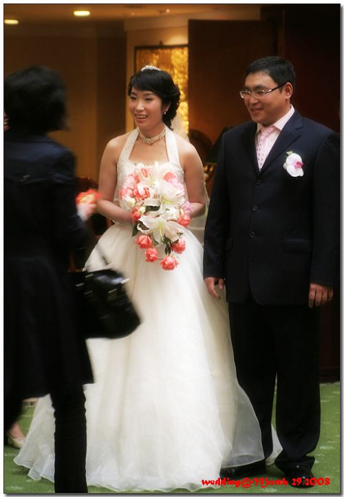
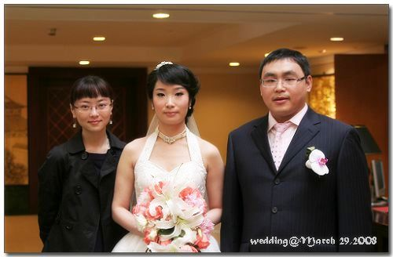

# 同事的婚礼

两位都是我的同事。  
新娘子和华裔女明星刘玉玲长得很象，是位留英研究生。新郎与我同部门，自从有了这位新娘子，真有些“瓦尔特保卫萨拉热窝”的劲儿，好歹是人家第一次恋爱。祝福他们！  
婚礼办的温馨而甜蜜，可我感觉不论哪场婚礼都有些小舞台剧的味道，下面的人边吃边看，上面的浓妆艳抹说着唱着朗诵皆流泪着....  
  
   
   

---

## 评论（1）

**mandy** · 2008-03-31

Marriage is the union of a man and a woman  
for better, for worse,for richer, for poorer,in sickness and in health,to love and to cherish,  
till parted by death.

