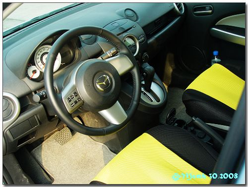
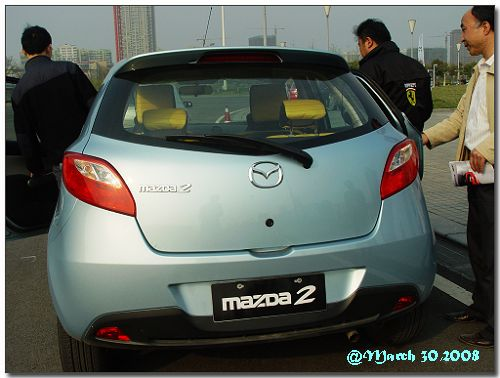
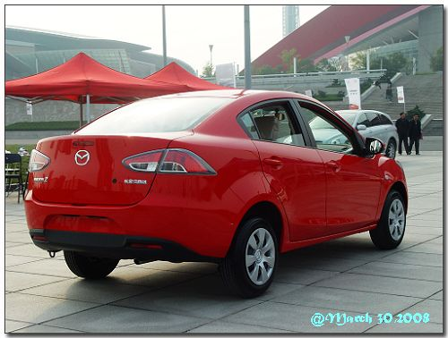
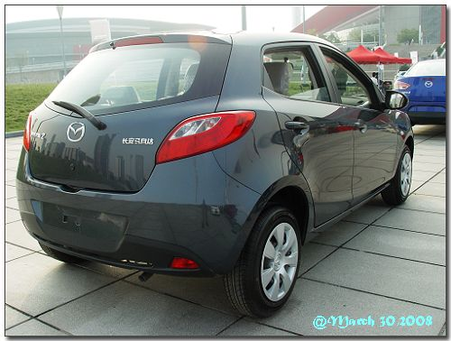
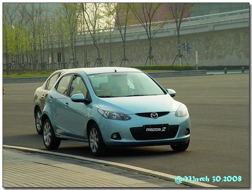

# 试车会

周日去奥体参加MAZDA 2试驾会，很喜欢两厢的外型，目前是1.3和1.5排量如果我没记错的话。内饰比较简单，后轮是鼓刹，可能出于降低成本考虑的。手动挡8万多，自动档10.13万。价格似乎偏高。  
   
   
   
   

---

## 评论（3）

**农妇某人** · 2008-04-01

最近很喜欢菲亚特刚出来的新版500，古典融合现代，很怀旧的感觉。

**叫兽** · 2008-04-02

马2是好车，马3也是好车。马6那是好车中的好车。

**阳光小虫** · 2008-04-02

マツダのデミオ（中国馬２）はすごくいいよ、日本よりやすい、運んでしやすい、特に1.5のスポーツ型お勧め。

