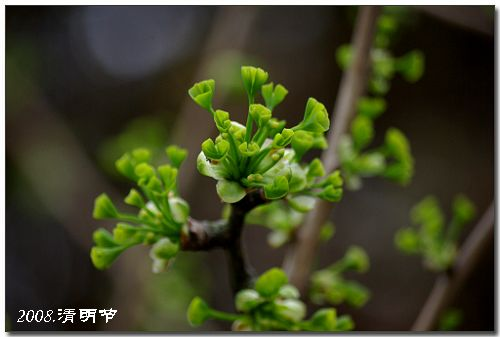
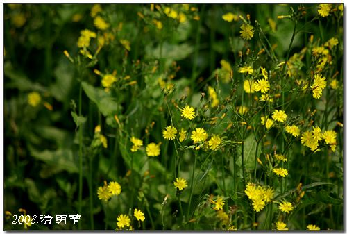
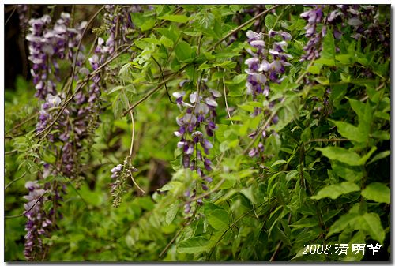
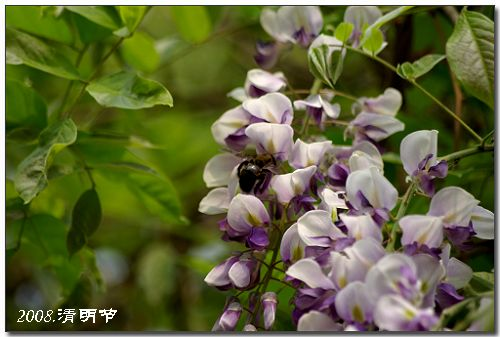
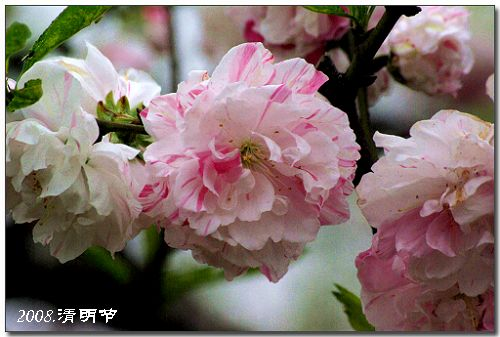
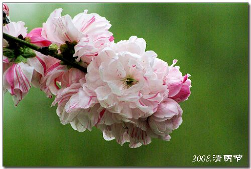
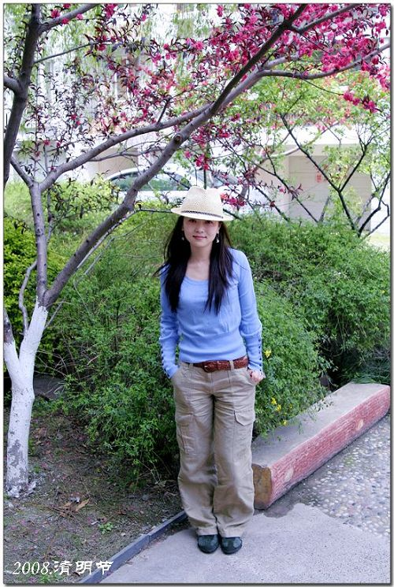

# 春花朵朵开

   
   
   
   
   
   

---

## 评论（5）

**[quinn](http://simplinice.wordpress.com.cn)** · 2008-04-07

这几张都是你拍的吗？感觉光线有些不足，是曝光不足还是因为天气啊  
比较喜欢第二张，那些细碎的，黄色花朵

**大姜炖去** · 2008-04-07

很喜欢第一张，嫩绿的小芽

**车同学** · 2008-04-08

挖 好美呀好美呀 我么有看到景色 只看到了人

**mandy** · 2008-04-08

都很喜欢！闲暇时看见一些花花草草我也喜欢用手机拍下来，虽然不专业，但是我喜欢 。紫藤~~让我想起我的母校！站在落下的花瓣里，尽情享受着花香。

**[绿恐龙](http://www.dlog.cn/dinosaur)** · 2008-04-08

好一个美人。。

