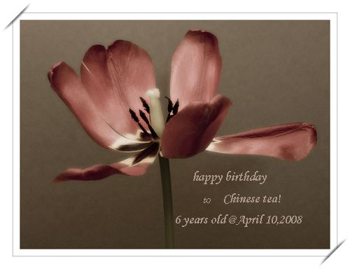

# 无题

幸福如果可以直接到站,  
何必绕来绕去?  

---

## 评论（16）

**COCO** · 2008-04-09

路过的风筝顺祝生日快乐!

**jolycai** · 2008-04-09

Happy birthday

**清息** · 2008-04-09

幸福如果可以直接到站,何必绕来绕去?  
经典！

**zyz** · 2008-04-09

恭喜，上幼儿园中班了

**mandy** · 2008-04-09

绕来绕去？那就多欣赏沿途的风景啊？那未必不是另一种幸福啊？

**大姜炖去** · 2008-04-09

等幸福来敲门的过程也是一种幸福

**农妇某人** · 2008-04-09

加油！请继续！

**okdata** · 2008-04-09

Nice picture, 不错的构图和色调，只是花开的盛了一点，象幸福的待嫁新娘。

直达的幸福易被忽视，曲折婉转才被珍惜。  
体会直达幸福需要境界和经历。  
唯有努力方知艰辛。

恭喜华诞

**[dersonlwd](http://hi.baidu.com/dersonlwd)** · 2008-04-10

路过，但常来，，

**雯子** · 2008-04-10

每天早上打开电脑就直接打开你的博这已成习惯呵呵。特喜欢上面些美丽的图片。Happy birthday

**mandy** · 2008-04-10

赞同okdata的话！~~直达的幸福易被忽视，曲折婉转才被珍惜。体会直达幸福需要境界和经历。唯有努力方知艰辛。

**nick** · 2008-04-10

不容易!再接再厉!

**[quinn](http://simplenice.wordpress.com.cn)** · 2008-04-10

生日快乐啊，原来你是白羊座，据说白羊很强势的，呵，在家是不是这样啊

**EDWARD** · 2008-04-11

恭喜！

**Christina** · 2008-04-11

Chinese Tea是白羊座的，我是狮子座的，据说白羊和狮子很相和：）

**abidingstar** · 2008-04-11

这里，给人一种很舒服的感觉。如同茶，越品越醇香。

