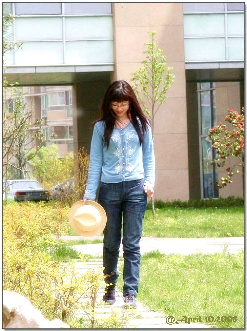

# 醉春风

[**more pix here**](http://photo.lifetea.org/v/life/4-10PS/)   
  

---

## 评论（7）

**[quinn](http://simplenice.wordpress.com.cn)** · 2008-04-10

第一张真是一直独秀啊，喜欢  
南京很暖和了吗

**大姜炖去** · 2008-04-10

这个是不是夜休梅？  
晚上花朵会合起来

**afan** · 2008-04-10

照出来没有以前那么sexy

**Michael** · 2008-04-10

好马配好鞍。现在就差配支猎枪或是套马绳子之类的东东了 :)

**okdata** · 2008-04-10

疯丫头， just match that small flower. Remind me my childhood in the third kindergarten at Gulou.

**[青花碎瓷](http://blog.sina.com.cn/chinatea)** · 2008-04-11

个人觉得你这个题有两解  
嘿嘿

**confus** · 2008-04-11

美女，MS丰润了些嘛

