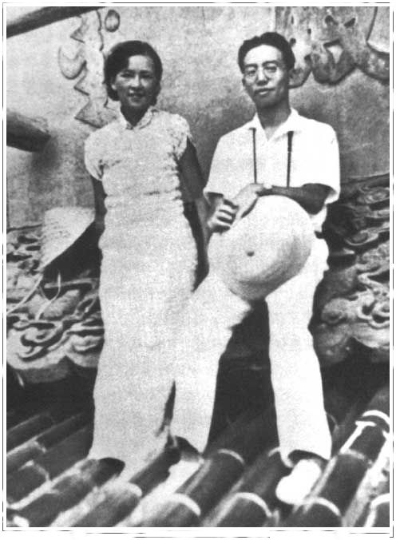

# 梁思成和林徽因

昨晚看东方卫视播“梁思成和林徽因对中国建筑史、创立中国建筑学科以及对于中国古建筑所作出的努力和贡献”，很喜欢这类节目，饶有兴趣的边看边想到今年香港博士即将毕业的娱儿，她学的就是古建筑，对于梁、林的联想也就很自然的具体到娱儿和她先生身上，他们俩也是学建筑的。同时也想到了徐志摩...  
  
林徽因从1935年后就已将曾用名“林徽音”改为“林徽因”。改名的原因是因为当时有个喜欢写常俗情爱小说的海派男作家与她同名，以至于时人老是将海派的林徽音误作京派（梁启超的儿媳）的林徽音，心志清高的徽因为了使自己与那个海派男林徽音相区别，就改“音”为“因”。  
  
林徽因是中国著名的建筑学家和作家，为中国第一位女性建筑学家，同时也被胡适誉为中国一代才女。三十年代初，与夫婿梁思成用现代科学方法研究中国古代建筑，成为这个学术领域的开拓者，后来在这方面获得了巨大的学术成就。  
  
林徽因最终选择嫁给梁思成而不是徐志摩，梁思成的魅力不像徐志摩一样是锋芒之美。他作为一个君子如玉石，美得隽永含蓄，梁思成不是一个轻易就能被异性爱上的男人，但他的才华不下于徐志摩，只是各人表达形式不同。由此可见林徽因最终选择梁思成完婚，是个聪明的女子。大概因为昨晚节目中我更欣赏和追求林与梁的感情人生，因此对徐志摩生出几许厌恶。与浪子恋爱，与君子结婚，被才子眷恋一生，即使有遗憾，都是温暖的一生。  
  
有关林徽因的书出了好几种，其中她生前任教的清华大学，编了本《建筑师林徽因》，开本宽大，印刷精美；还有一本是梁思成续弦夫人林洙的回忆录《梁思成林徽因和我》。另外，陕西师大出版社也出了2种：《记忆中的林徽因》和《林徽因讲建筑》，前者和清华的那本一样，主要是亲人、师友、学生的回忆性文章，且多有重复，后一本是林徽因建筑学文章的选集。有空可以找来读读。  
  
梁思成和林徽因站在当时测绘的古建筑屋檐上  

---

## 评论（5）

**huntun** · 2008-04-15

嘿嘿,她在天涯上被拍的不轻啊,反正人无完人,要真没缺点就假了,她对建筑的热爱很执著啊!

**Christina** · 2008-04-16

我比较喜欢林徽因滴~更欣赏梁思成的人品~

**[蘇泊爾™](http://www.douban.com/people/nokia2100/)** · 2008-04-16

原来“中国茶”也是梁、林伉俪两位建筑学家的FANS，OH YEAH~~潜“茶”近三年了，这次决定出水透口气。

**大姜炖去** · 2008-04-16

(转某人的一段话)若论近现代中国第一才女，非林徽因莫属，三个举世无双的优秀男人终身都为她而痛苦：一个摔断了腿（梁思成为博美人一笑，失急慌忙掉下车来），另一个为觅得佳人，嫌飞机太慢，自己先飞下来了（徐志摩），这最后一个，就是我们的金岳霖先生，为了她，一辈子不娶，且与情敌毗邻而居，终身为友，一段情，文坛人士共惊闻。   
女子当如林徽因，情人当若金岳霖

**Christina** · 2008-04-16

一生美丽的林徽因，才华突出，别说男人了连女人都喜欢她~

