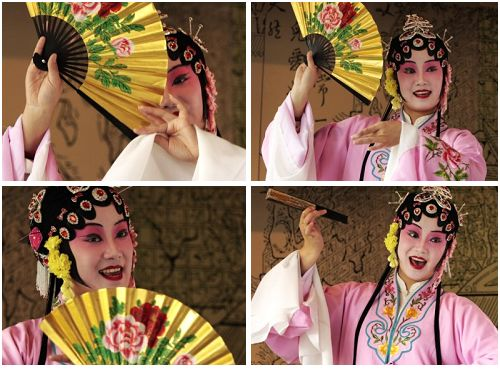
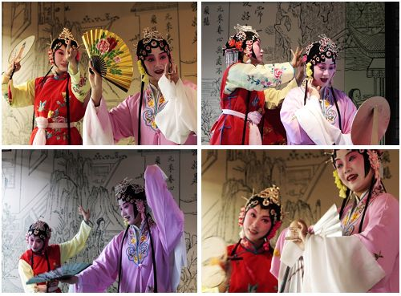
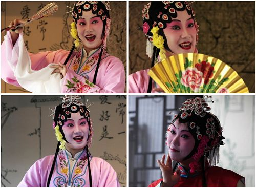
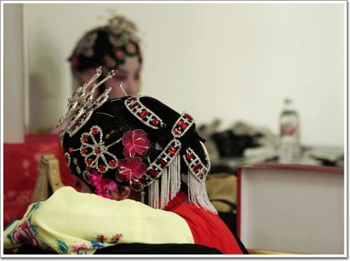

# 烟丝醉软，燕语如剪

曾看过一个电视节目介绍一些商人南曲北调，将昆曲包装成品位、风雅与时尚的作品放在[**“皇家粮仓”**](http://www.imperialgranary.com.cn/index1.asp)演出。皇家粮仓建于明永乐7年，距今已有600年的历史，是京城保存最完好的古粮仓。现在那里承办新闻发布、庆典、论坛、年会、首映、演出、酒会等商务活动。  
  
大概只有北京才能找到象“皇家粮仓”这样的地方，如此适合昆曲的气质，绝对一流的硬件条件，让演戏与赏戏成为一种至尊的享受。且不讨论票价有多么昂贵，外界有多少争议，至少制作方在认真经营这门艺术也好，生意也罢，若能坚持下去，必定能让古老戏曲走出一条独特的发展之路。昆曲确实是戏曲中最高美学范畴，属于“曲”高小众艺术。应香港拔萃男书院盛情邀请，[皇家粮仓厅堂版《牡丹亭》](http://www.imperialgranary.com.cn/origin/detail.asp?iInfoID=147)于4月13日载誉赴港演出，演出共三晚。4月14、 15日邀请不同的中学生欣赏, 而 16日则专为拔萃男书院旧生及家长而设。  
  
今天在王刚的SPACE里看到他新拍的一组[**昆曲《牡丹亭》**](http://factorwanggang.spaces.live.com/blog/)的照片，甚是喜欢。《牡丹亭》也曾在南京演出，财务有个MM去看滴，我特纳闷的是是外形如此哈日哈韩的MM怎么会喜欢戏曲？我是以貌取人了，于丹的偶像还是周杰伦呢，不难理解。于丹说：“我只做我认为该做的事。自己喜欢才去做。并非要大家都去喜欢。我做事很少想结果，很少去想它的价值。我从小就喜欢昆曲，就因为它有太多超越。今天的人们凡事都追问价值，本身就不平衡，太过功利。我们就不能有点纯粹的审美价值吗？今天来看，昆曲就是一场审美方式。它将文学、舞蹈、音乐完美地融合在一起。”  
  
   
   
   
  
多漂亮的头饰啊，小时侯我曾用纽扣自己动手制作戏剧上用的头饰和簪花。  

---

## 评论（6）

**Annie** · 2008-04-28

也喜欢昆曲，总有些东西提醒你怀念北京~

**光光** · 2008-04-29

5月6日-15日，坂东玉三郎先生将在北京湖广会馆公演昆曲 《牡丹亭》。

**大姜炖去** · 2008-05-03

于丹同学好像要来上海讲昆曲

**叫兽** · 2008-05-05

porn无情，actrice无义

**njujessica** · 2008-05-05

为什么我的留言看不到? 伤心…  
昆剧还蛮看到的,上次白先勇的<<青春版牡丹亭>>来南京连续三晚,每晚不到.虽然当时留给我们学生的票都是很后排,但是大家都热情很高,有些人即使为了能近距离的观看演出,不惜坐在前面的地上.  
所以,不是我们青年一代不喜欢中国古老的艺术,而是这种接触的机会太少.

**Christina** · 2008-05-05

你的留言不仅能看到，而且还留了两遍，发送留言后最好刷新一下，留言才能出来，呵呵~

