# 南京云锦

前些时候周杰伦来南京开演唱会，江苏电视台《人间》栏目采访他时赠送的就是南京的云锦艺术品。去参观南京云锦研究所时，房间里太安静，只有织布机机工作的声音，有些冰冷乏味，应该在那些织工工作的时候给他们放点背景音乐，有益于舒缓枯燥的工作情绪。这点大明路上的新奇特就特好，人性~  
  
[**南京云锦**](http://www.js.xinhuanet.com/xin_wen_zhong_xin/2005-07/18/content_4663700.htm)起源于距今1500多年前，因美如天上的云霞而得名，元、明、清三朝均为皇家御用贡品，云锦的生产主要采用传统花楼织机手工织造，一天产量只有几公分，目前这种独特的织造技艺还无法用现代机器替代。  
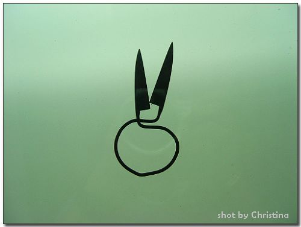   
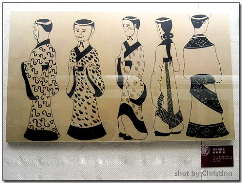   
   
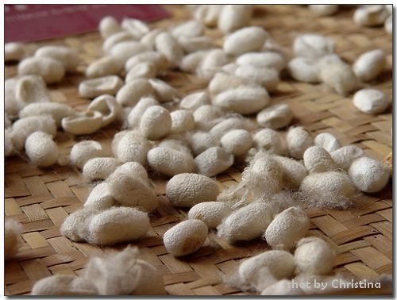   
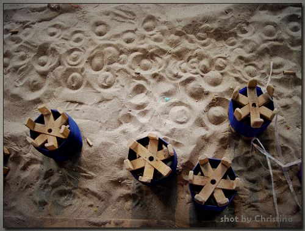   
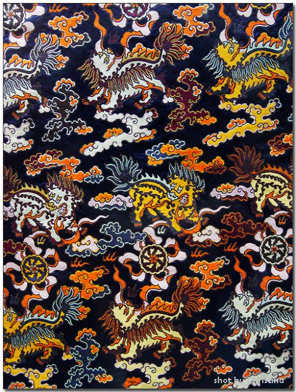   
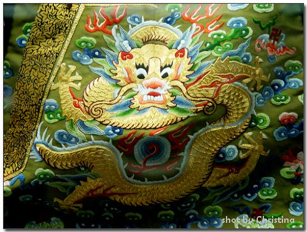   
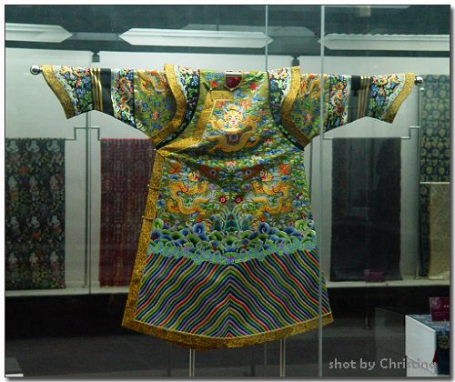   
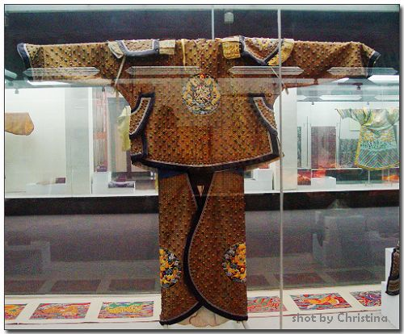   
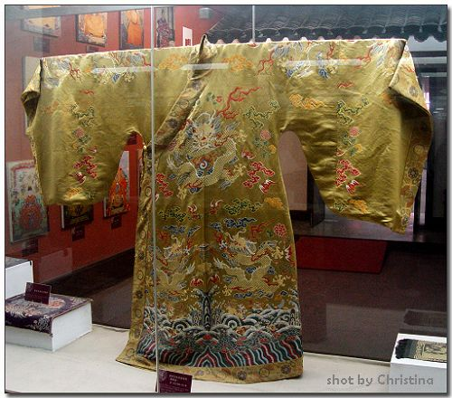   
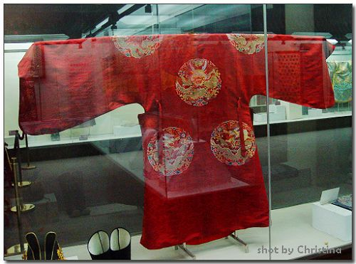  
  
上面那些精美的花纹面料就是这样的织布机完成的，两个织工手脚并用同时操作。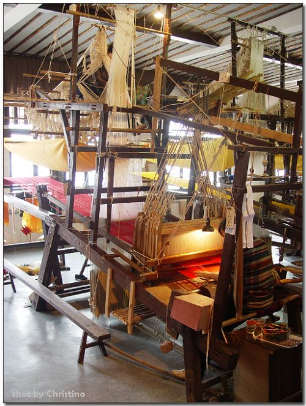

---

## 评论（4）

**[青花碎瓷](http://blog.sina.com.cn/chinatea)** · 2008-05-05

好美

**Dan** · 2008-05-05

去年10-1去了南京，夫子庙里就专门有人现场表演云锦工艺的。一台织机同时需要两人配合操作，工艺繁琐。很难想象，那么多复杂的图案，他们是如何用一根根线在织机上实现的。听说有的还用到金线和孔雀毛。

**Michael** · 2008-05-09

这才有中国特色. 把这些放到镜框里面表起来,看起来真的很好看的. 我买了些小的送客户.

**treeinrain** · 2008-05-11

长见识了.:)

