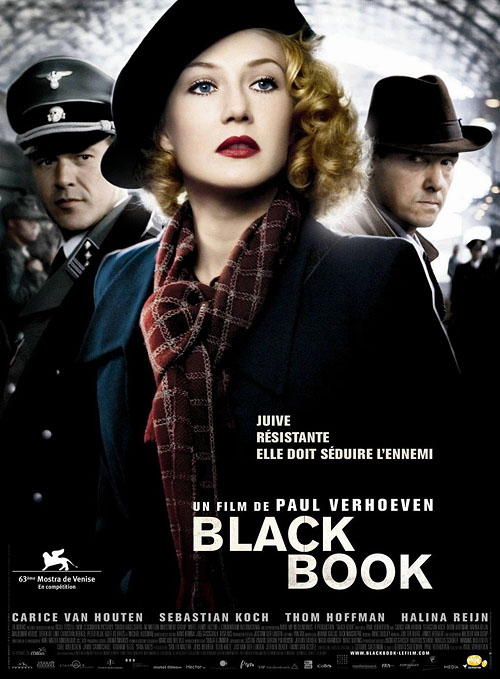

# 《Black Book》

节前挑了张06年上映的电影[**《Black Book》**](http://www.zwartboekdefilm.nl/)看，这部电影是《本能》导演Paul Verhoeven在自己家乡荷兰以母语摄制的，讲述二战期间的反战故事。和《色戒》差不多类型，性与暴力、女主角爱上敌人，只是《色戒》以个人感情对抗历史的大是大非，而《Black Book》的最终结局是德军军官抛弃了纳粹，转向了抵抗组织。电影永远要承担教化功能，不是吗？  
  
让人印象深刻的还有电影中的美女主角Van Houten、赤裸上阵的迤逦风光、女主人公的智慧和毅志力...看过这部电影我想我会记住这位女演员Van Houten，这部电影在[*豆瓣*](http://www.douban.com/subject/1858802/)相当受欢迎，观众的评论也比较精彩：  
  
  
  
viennavirus(北京)：人类有个很令人憎恶的毛病，就是猎奇。属于他人的苦难，即便再深重，只要它有可供猎奇的部分，比如性和暴力，人们就会趋之若鹜。从伊拉克虐囚到广东高中女生打架视频传播，无不如此，就像苏珊桑塔格说的，仅仅是为了取乐。一个庸才导演，故事讲的不咸不淡，也没能渲染出情绪，甚至从根本上就是持错误的态度来拍戏（比如打着唤起沉痛记忆的名义来娱乐），那么观者只好期待着猎奇。从这点上来说，**掌控痛苦比掌控快乐更为艰难。**  
  
......好在这部号称筹备了二十年的电影，远没有这么简单。Gerard Soeteman的剧本让电影有了史诗的美誉，当然，这是一部女人的战争史诗。除了老套的“男人的战争，女人的牺牲”之外，后半段转折更加出人意表。战争结束了，却远未结束，原来女人为之牺牲的，看似正义的战争，也是一场勾兑。没有简单的对阵双方一分为二，有的只是人性的善恶，而让人变丑陋的，是战争。用一个女孩一夜长大的故事，无疑比单纯男人的较量更令人心动。  
  
mimi2007 (上海)： 色戒》基本上成了《黑皮书》的中国版。只是《黑皮书》把整个故事讲得更流畅，对人性的反思也更深入。要说表达“留给人性一点空间”这样的主题，这个片子才算真正做到了。《色戒》只不过是《黑皮书》要说的1/3还不到。   
  
一部片子是不是用心拍的，大多数观众还是能看出来。《色戒》完整版我也看了，可是感觉说得太不透，而且商业得有点过了，实现了找准了卖点的定向包装——卖给外国人的是老上海风情，卖给台湾人的是重庆政府的旧日艰险和荣光，卖给大陆人的是张爱玲和床戏。  
  
yy (北京) ：随随便便开始，认认真真结束，这部片子给人的感觉就是这样。很长，却让人没有办法停下来。

---

## 评论（5）

**叫兽** · 2008-05-06

我更爱《爱在战火蔓延时》。

**Christina** · 2008-05-06

改天找来看看究竟如何?!呵呵~

**[robert.chen](http://www.revel.cn)** · 2008-05-06

这次来chinese tea,终于看到了我想看到的东东。难得写得这么深动，我回去下载来看看哈。

**叫兽** · 2008-05-06

中央6有放过。虽然是怪腔怪调的国语配音，小生仍然被感动得鼻子眼泪一大把。值得看看。

**afan** · 2008-05-06

中央6放赤裸上阵?

