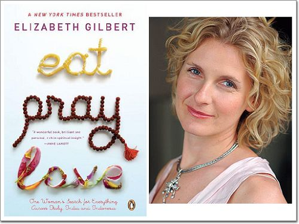

# home in mind

**离开温暖舒适的家，人往往可以遇到另外一个自己。**   
  
   
  
令人心声启迪的Elizabeth Gilbert，一个三十四岁的离婚女子，回首来时路，怅然若失。她撰写的[《Eat, Pray, Love》](http://book.qq.com/s/book/0/12/12398/index.shtml)，荣获时代杂志2008百大最有影响力的人物，雄踞2007年全美年度畅销排行榜第三名，连前美国第一夫人希拉里-克林顿对它都青睐有加。超过在美国大热的《灿烂千阳》、《追风筝的人》和《大象的眼泪》。  
  
**懂得放弃和改变的女人，即使我们不再漂亮，不再年轻，仍然可以一辈子做女孩！**作者Elizabeth Gilbert在小时候有个梦想：长大后会是儿女成群的妈妈。但在30岁以后，她才发现自己既不想要小孩，也不想要丈夫。在令人疲惫的婚姻结束之后，作者在意大利、印度、印尼三个不同国度之间寻找自己，Elizabeth离开纽约只剩下自己一个人的“家”，在意大利，她的灵魂再生；在印度，她洗涤了混乱的身心；在巴厘岛，她寻得了身心的平衡。这一年的流浪，让她发现“拯救我的人，并非王子，而是我自己操控我，拯救我”。  
  
社会学家李银河说：“女人首先是一个人，其次才是一个女人。我认为本书的作者写出了女人的心声。越来越多的女人会认识到：女人有自己独立于男人的价值。”相信她会找到自己的家，无论它在哪里。  
  
*作者简介：伊莉莎白·吉尔伯特，小说家、新闻记者、两度获得National Magazine Award 深度报导奖，作品The Last American Man 入选美国国家图书奖决赛名单及2002年纽约时代年代好书，故事集Pilgrims获得Paris Review 最佳新人小说等奖项。曾为知名杂志GQ、Bazaar、The New York Magazine撰稿。*

---

## 评论（1）

**ANGEL** · 2008-06-16

家，灵魂的收容所 ：）

