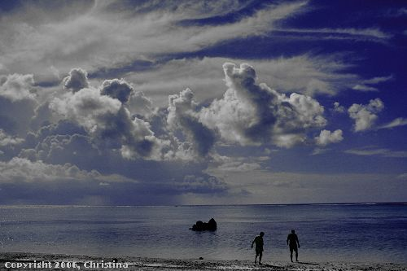

# 参展

公司选了我拍摄的三张照片到集团参加展览，洗出来的色彩与我在电脑上看到的不同，效果必然会不同，而且用的是白底板，如果是黑色的可能会好一些。兄弟公司有个人摄影作品真是狂好，据说是南艺毕业的，在企业里搞样宣，用的都是公司配备的高档设备，羡慕啊~所有展出的作品都放在大厦走廊里，同时还有一些书画作品，相信还有高手没参加这次活动，所以给了我这种爱好者展示的机会。通过看展览反省自己目前还做不到有条理的管理自己拍下的照片，这个特别需要改进。  
  
我最喜欢的是这幅照片，它包容着丰富深沉的情绪，每每看久了都会很着迷PP中的氛围。  
没想到会有知音，被选中拿去参展。  

---

## 评论（10）

**[Tony](http://www.flickr.com/photos/traveller/)** · 2008-06-17

很不錯啊! 不知其他的2張是怎樣的?

:)

**MAGGIE** · 2008-06-18

非常喜欢这张照片的意境，以前没见展示过嘛！

**Christina** · 2008-06-18

当然有展示过，不止一次。  
其它两张我认为一般般，他们居然还选中了。

**[薇安](http://www.bulaoge.com/?vivianxu)** · 2008-06-18

这张确实很漂亮，塞班啊。。。。

**recoo** · 2008-06-18

你的摄影装备有哪些？  
准备向您看齐

**mandy** · 2008-06-18

喜欢

**Christina** · 2008-06-18

就一只CANON 350D.

**njujessica** · 2008-06-18

今天中午去看了， 你说的那个人确是牛人。这张照片中的是lin和y吧

**christina** · 2008-06-19

是的呀~

**okdata** · 2008-06-19

层次空间，想象无限  
水天几乎一体，有些禅意  
色调稍亮可少些压抑

