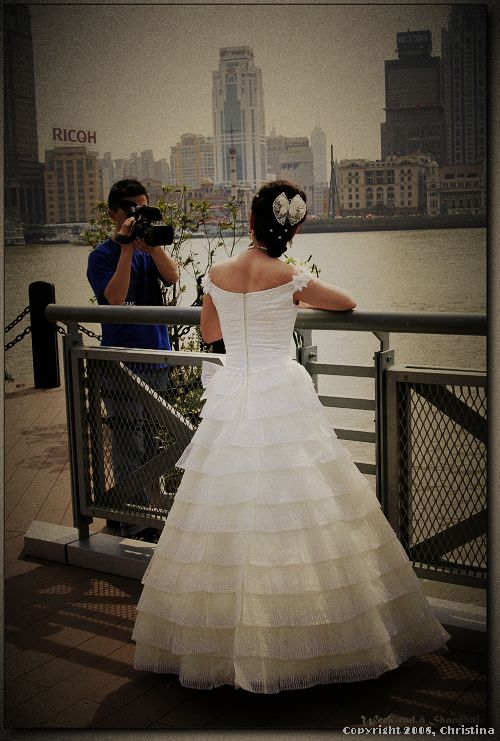

# 数学.题

充实的工作了一整天，几乎80%都是和价格有关。  
想到“生命诚可贵，爱情价更高”，这句仿佛在谈精神又的确谈到了“价”格？  
在日新月异的涨价时代是否什么都可以抛？  
这时代有不涨价的东西吗？  
涨价是复杂的数学题，复杂意味着不纯粹不单纯...  
接着咋就想到“这时代还有纯洁的婚姻吗？”  
  
越是那些表面看似完美的，虚假的成份却更多。  
粉饰得越好越不是他/她说的那样。  
真可谓：外面的自己做着大众认可的事儿，里面的自己却总在背道而弛。  
谁真正有权利站在道德的审判席上指手画脚？你？你？还是你？  
  
想爱就去爱吧，不必那么虚伪。  
  

---

## 评论（4）

**叫兽** · 2008-06-19

涨价+本币升值=外贸死光光

你要是下岗了还有方法讨生活，那些公司养的闲人估计只能沿街乞讨了

**okdata** · 2008-06-19

价格和人格，有时成正比  
纯洁不是梦境，不应是男人梦中新娘，抑或女人的白马王子  
恰如此处的婚纱，撇去炫丽的背面展示更多的真实  
片片的构图与加工传递着美化的生活  
配楼主的感慨，合适  
贴句不合适的话：  
人类一思考，上帝就发笑

**zyz** · 2008-06-20

70岁结婚,那时候的婚姻应该是纯洁的…

**COCO** · 2008-06-21

两个人的恋爱可以“纯粹”,两个人的婚姻……太复杂.对,想爱就爱吧，不必那么虚伪。

