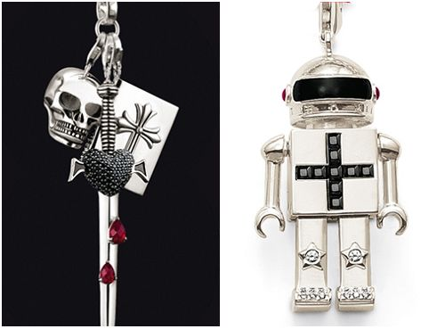
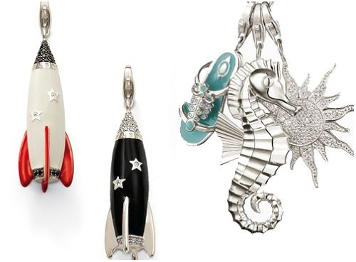

# 喜欢的设计

朋友向我推荐了一个新上柜的首饰品牌，说肯定符合我的审美，翻过首饰画册立刻喜欢上它的设计。非常有意思的是顾客可以自行选择挂坠，一个两个...N个搭配着戴。  
就象吃过“翅爽”，朋友讲好东西不要介绍给别人，要自己留着，所以我还是不讲这个首饰的名字啦：）我是一根筋的人，喜欢什么东西会一段时间盯着买，压根不去看其他相似产品是否还有更好的选择，可一旦注意力从A转移到B，起初心里感觉会对不住A。然而设计师换了，设计风格肯定也会变，不转移是不是也对不住自己呢？人，都是自私滴，不是吗？  
  
   

---

## 评论（9）

**a guy in USA** · 2008-06-21

I just brought a house, but I don’t know anything about the interior design. My house is huge, 3 car garage, 3150 sq feet. I have to pay 10 thousand bucks for hiring a designer. It is way too much.

**coco** · 2008-06-21

恩,这个蛮有质感滴.以前会看到一些喜欢的“百怪“装饰,只是很遗憾它们的材质和做工.大多数人总是会被新异的东西所吸引.不是“对不住”,是“进步”,是吧?呵呵

**okdata** · 2008-06-22

35岁前不知道要什么，35岁后不知道还有多少机会  
定型是很可怕的东西，无论是思维还是生活  
极羡慕那些扛着年轮与时代同步的人，  
赶得上，真幸福

**叫兽** · 2008-06-23

挺可爱的，适合装嫩。我也喜欢

**Christina** · 2008-06-23

这个品牌也有一些很女人很浪漫的首饰：）每个成年人都有一颗童心，呵呵~~

**叫兽** · 2008-06-23

那我这样没长大的就更应该有颗童心了。可是有颗童心的成年人其实太少了，很多保持童真的大人都会被伤害得很深，接着就失去童心。

所以小奥斯卡不想长大，所以宋江要杀老婆当强盗

**Christina** · 2008-06-23

很多保持童真的大人都会被伤害得很深，接着就失去童心….

非常真实！象你这样没长大的还真了解社会：）

**叫兽** · 2008-06-24

身体长大了，心里却不想长大。所以把自己给整拧巴了。  
吃了点苦，受了点罪，现在特想回到过去，撒丫子可着劲儿的玩

**bbjun** · 2008-06-26

Christina ,非常非常喜欢，可否告知品牌跟销售地点，避免广告，请发我E MAIL，谢谢，不胜感激！！

