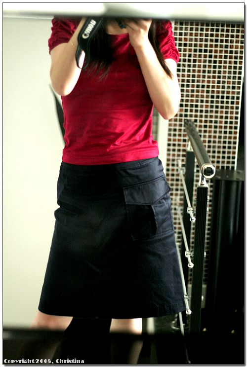
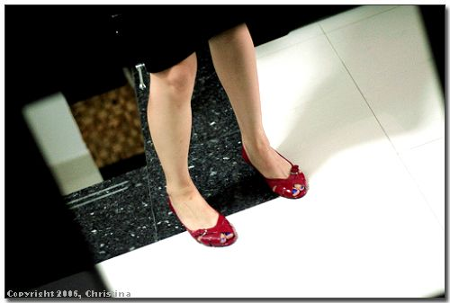
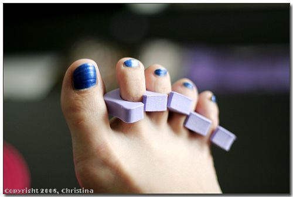

# 此时彼刻

能经常照顾到手脚的女人一定非常有闲。  
能每天按摩手脚，甚至在指甲上涂抹喜爱的指甲油对于我是很奢侈的时刻。  
压力和忙碌有时剥夺了你作为女人的一些权利。  
  
   
   

---

## 评论（17）

**叫兽** · 2008-06-24

坐脚丫子的沙发。  
保养得不错，看起来没受过太多脚气、老茧、死皮和高跟鞋的折磨。  
女人就是好，像我这样脏兮兮的男的肯定没勇气自曝脚丫~

**okdata** · 2008-06-24

裙子和T恤的质地不错，协调  
指甲的颜色如为暖色系会更好  
压力和忙碌剥夺着所有人的权利

**农妇某人** · 2008-06-25

我看那双鞋子好像很眼熟啊？！是不是ecco的啊？！不要告诉我说你也有这双鞋子啊……

**Christina** · 2008-06-25

是ecco的,呵呵~好眼力~每个人是不是都存有叛逆的心理？蓝色指甲油不适合上班，可是我却特别想这么做~

**Sherry** · 2008-06-25

“瘦”就是王道，穿啥都好看！

**Christina** · 2008-06-25

你最近还是胖兔子吗？呵呵~

**[薇安](http://www.bulaoge.com/?vivianxu)** · 2008-06-25

呵呵，我喜欢紫色和朱红色做脚指甲油。

翻到我06年写的一篇。给你看看  
http://www.bulaoge.com/topic.blg?dmn=vivianxu&tid=76636#Content

**[joanna](http://yanmer.info/blog)** · 2008-06-25

裙子是kookai?宝蓝色很好看，连这也不合适office?

**Christina** · 2008-06-25

也许国内不适合吧，不知道，要看工作环境和职业，你要搞艺术肯定没问题，在办公室可能不合适，我们这里周围人都很保守的，也很虚伪，呵呵。

**enriquesun** · 2008-06-25

脚丫子都出来了？  
不知为什么  
不喜欢看到

**okdata** · 2008-06-25

haha, 童真的叛逆  
办公室的鲶鱼  
要是在北京西路大院……

**ZHI** · 2008-06-26

喜欢这种有点色差的红和黑，很协调，现在能看到FLICKR图片了吗，我郁闷的都很久没有写博了。

**Christina** · 2008-06-26

enriquesun有精神洁癖吗?  
以前我特不愿意光脚穿凉鞋，看到别人穿人字拖也别扭，主要原因和enriquesun一样看到不穿袜子的脚心里怪怪的感觉。

**Christina** · 2008-06-26

ZHI ，看看这几个连接吧：  
http://blog.istef.info/2007/06/08/save-flickr/  
http://www.williamlong.info/?tags=Flickr

这就是用免费网站不好的地方，受人限制，因为是免费的还无法申诉~

**zyz** · 2008-06-26

喜欢衣服这红！NICE 。

**Sherry** · 2008-06-27

我恐怕一直都会是只肥兔子了。。

**Brad** · 2008-07-04

女人廋才是王道，男人廋就不行了。我穿啥都不行。

