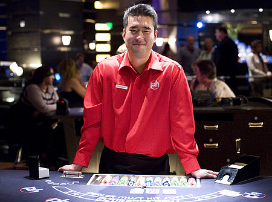

# Black jack

上周出差三天，仍然用周日看了三部片子： [《21》](http://datalib.ent.qq.com/movie/3751/index.shtml)、 [《Superhero Movie》](http://data.ent.163.com/ent/movie/one/id=00030BOdCMBM.html)、 [《Vantage Point》](http://ent.sina.com.cn/m/f/vantagepoint/index.html)，无一不精彩。  
  
其中最有趣的是《21》，它改编自本·莫兹里奇在2002年出版的畅销小说，书中所有的故事均真实发生过，94年就有数位麻省理工学院高材生由数学教授引导在拉斯维加斯赢了数百万美元，这些学生还写过一篇《21点》的论文，你现在在网络上搜索仍然可以搜到这篇论文。当赌博被归结为数学题，一切似乎变得更加简单。  
  
马恺文客串庄家  
  
  
现年36岁的华裔马恺文就是当年凭着“英特尔芯片”般的超级神算能力与同学横扫美国各个堵场，手气好的时候一晚上能赢几百万美元的麻省理工学院的高材生，他们渐渐成为赌场不受欢迎的人，上了黑名单。现在他专门开班授课，教授如何算牌。  
  
1994年的马恺文读大三，并准备上哈佛的医学院，两个同学邀他参加“麻省理工21点小组”，事实上在1979年麻省理工学院便出现了一个“非赌不可怎么赌”的迷你课程，让精通数学的学生切磋“21点”的算牌技巧。马恺文说算牌只能提高3%的赢牌机率，虽然是很简单的算数，但足以造成很大的差别。每个周末马恺文和同学带着10万美元转战各个赌场，有时一个晚上能赢90多万美元。为防止真实身份暴露，他们经常化妆成牛仔、商人、棒球队员...前往赌场。  
  
该故事吸引了好莱坞的注意，投资方甚至连小说都没看，便决定开拍电影。马恺文除了做影片指导外，还客串赌场的庄家。饰演当年马恺文的是英国演员Jim Sturgess，对于好莱坞用白人影星饰演马恺文，不少美国亚裔在影片上映后表示不满。起初投资方担心马恺文会因此不悦，但马恺文认为：“他更看中的是演员是否能演出自己的性格及与同学之间的互动，如果电影公司随便找个亚洲演员，比如日本人或韩国人来扮演马恺文，那会是更大侮辱。”

---

## 评论（3）

**叫兽** · 2008-07-02

看过这部电影了，非常烂  
传奇故事被拍成了大学厕所里的校园青春剧  
美国人民有时候境界也不咋地

**a guy in the USA** · 2008-07-03

I watched a document TV show about MIT Blackjack Team on HISTORY Channel. There are very smart people and MIT has very good program. It simulates young people to study Math. Math is a fantastic science and I love it.

**jason** · 2008-08-31

这部电影完全是瞎说

