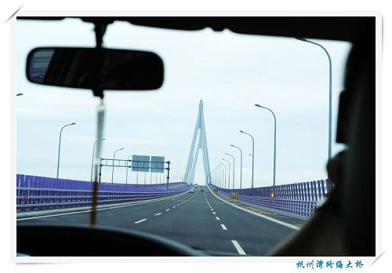
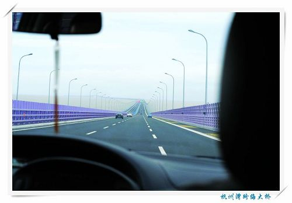
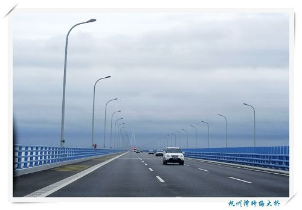
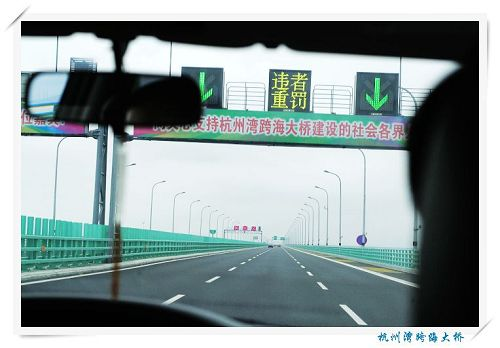
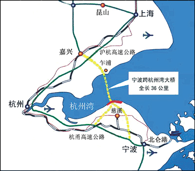

# 杭州跨海大桥

出差第一次从杭州跨海大桥走，壮观。  
全长36公里，过桥不是80就是100元，没弄清楚。  
  
之前电视节目介绍过这座桥的建设，全部是国内自主架设，连打桩机都是专门为这桥量身订做。使用寿命100年，100年后这桥如何从海上拆除呢？  
  
想起看过的一部片子 [《Children of Men》](http://yule.sohu.com/s2006/renzz/)中展现的未来不是高科技、不是干净到无尘的世界，人类更不是大自然的主宰，而是污染严重饱受环境恶劣之苦的生活，以至于世界上已经18年没有妇女生过孩子了...100年后我们也许真的会生活在垃圾堆上...  
  
   
   
   
   

---

## 评论（5）

**afan** · 2008-07-02

想起上次的一则新闻，这么长的桥有人在桥上突然想去厕所怎么办？

**EDWARD** · 2008-07-03

开得很爽吧？呵呵

**Christina** · 2008-07-03

桥上有休息站和观景台，公司的司机开的车~

**叫兽** · 2008-07-03

边开车边拍照需要一心二用，竟然没有糊，姐姐牛！

**yezi** · 2008-07-04

我第一次过桥的时候扒在车窗上看啊看啊，最后眼睛看花了，把泥黄色的海水看成是泥滩，一直在纳闷着怎么还没到海里。没过桥之前的想像好些。

