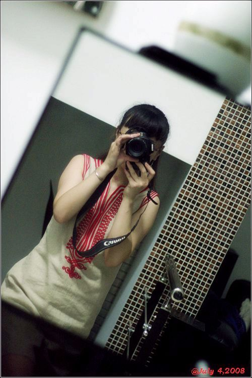
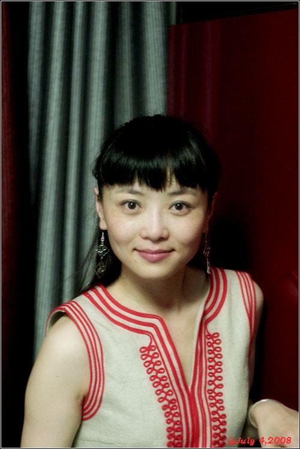

# 橘红色.饰边

出梅后炎热的夏天开始折磨人了。  
不在空调房间时脸上象是水浇过似的一片一片的汗。  
春天便买了的棉麻连衣裙，现在才有机会穿上，喜欢上面的饰边，很民族。  
  
出差时穿的凉鞋，一天坏一只，回来便扔了。  
今年夏天缺一双平底凉鞋，逛了几次发现今年的凉鞋大多bling bling，唯一一双金色的坡跟凉鞋出勤率也是非常之低，其实有些高跟鞋真的很惹人喜爱，买回来却变成了收藏。还是配平底鞋自在些，象我这样大步流星走路的人，高跟上总有些不自在，不知是不习惯还是怕自己太高？那种心理好象开会时你总喜欢坐在人群后面，大街上你的颜色总是朴素，然而细节上所传达的气质却无法被周遭淹没...  
  
   
   

---

## 评论（13）

**a guy in USA** · 2008-07-07

Your apartment looks nice. We have to pay much more to cool down and heat up this year than before. The price hits sky and economic is going down.

**ANGEL** · 2008-07-07

茶，你一直不胖啊，怎么保养的啊~

**Christina** · 2008-07-07

青春期发育的时候挺胖的，110几斤重，20多岁就渐渐瘦了，到现在一直保持在94~98斤之间（光脚1.645M高），偏瘦。我希望能再胖一点，100斤到102斤之间比较好。

因为没有体型方面的烦恼，所以还真没保养过体型。说实话我还特喜欢吃荤菜，胖或者瘦首先会受遗传影响吧？

30好几岁了最困扰我的是肌肉有日渐松弛的趋势，这需要器械运动来保持肌肉的形状。

**叫兽** · 2008-07-07

怎么看起来有点象白灵？  
不纯洁80后飘过~~

**芝麻** · 2008-07-07

最后一张,有点象高山族的美女:)

**JC Li** · 2008-07-07

发型改了， ：）

**Lucy** · 2008-07-07

怎么看也不象白灵啊，比她漂亮多了！

**amily** · 2008-07-07

按照她的年龄应该是很年轻的了,这个年龄的女人最有魅力和吸引力。你会不会叫自己的妈妈为老女人呢？

**[小雨佳文](http://www.irelandscape.net)** · 2008-07-07

初次来你的博客,不错.挺有特点.我是留爱华人.现已回国.上面是我的爱尔兰博客.有兴趣可以交换个链接哦.

**tianw** · 2008-07-07

你真的老了很多呀，注意身体

**Christina** · 2008-07-07

不老的是妖精：）

**okdata** · 2008-07-10

Haha….“bling bling”  
看来婚姻能减肥:)

**okdata** · 2008-07-10

楼道马赛克边墙、扶手配浅镜砖深边地面，银镜、镜台，家具、墙壁，质感清爽坚硬，凉快

