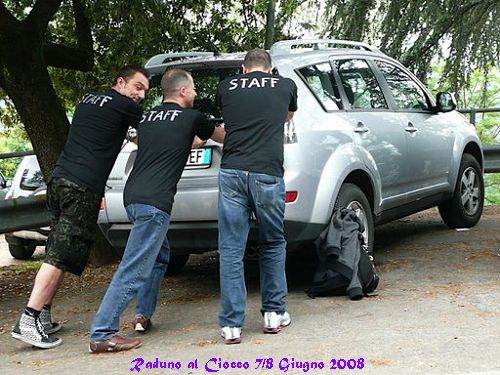
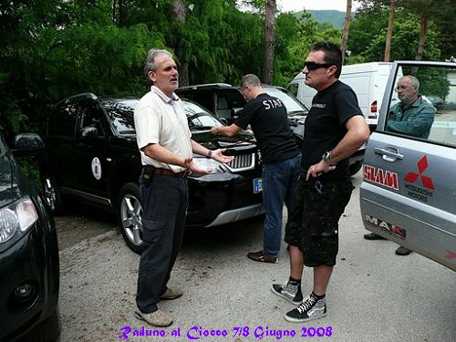
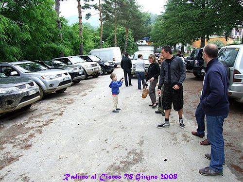
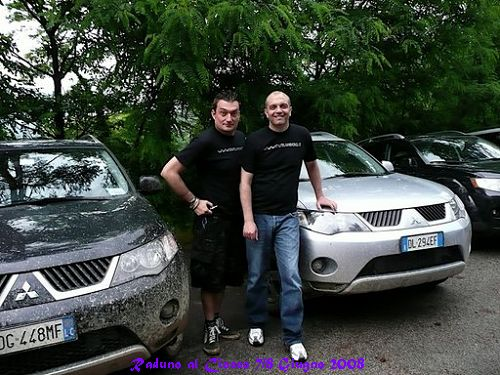
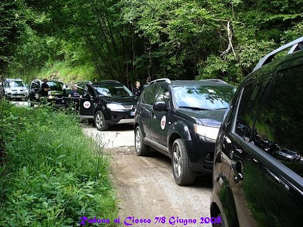
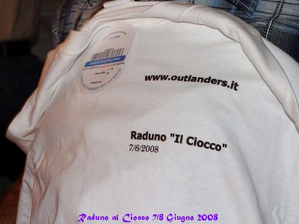
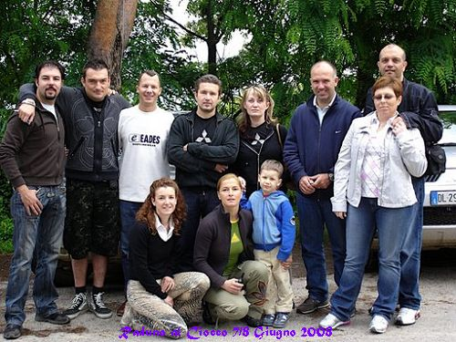
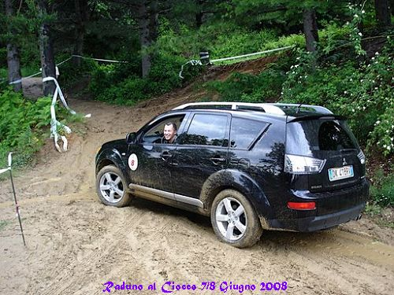
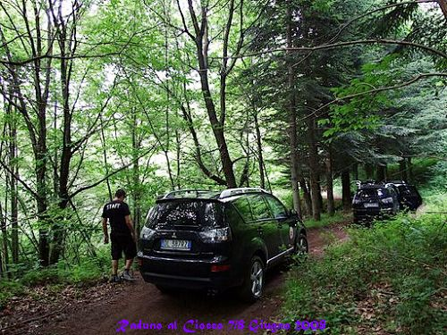
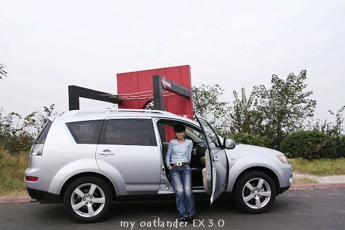

# outlander & outlanders

意大利outlander聚会的照片，看来中国进口的outlander是欧洲版滴？  
一直钟情于黑色，可是在中国选黑色的车车很麻烦，基本洗车之后两小时上面就一层灰。  
让车车大部分时候保持黑色有光泽的状态比较难，所以还是选了银灰色的outlander。  
等N年后再换车也许会选一款黑色系的车车~  
  
提醒：夏天千万别把打火机放在车厢里，尤其当车停在户外无遮挡的地方曝晒时。  
在刚刚过去的周末，一只打火机在朋友的车厢里爆炸了，好在周围没有纸片或易燃易爆物品。  
  
   
   
   
   
   
   
   
   
   
  
这是俺的outlander~  

---

## 评论（2）

**Anna** · 2008-07-08

挺耗油吧?现在开了多少公里了?

**Christina** · 2008-07-08

1.5万公里了，还行，市区龟速12、13L/百公里，打空调14、15，高架80公里匀速、手动模式，开过7.9L/每百公里：）和驾驶习惯有关~

