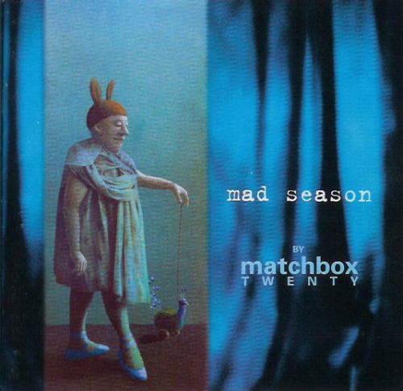

# bent

   
  
*专辑名称：Mad Season  
专辑歌手：Matchbox Twenty  
发行时间：2000年*  
  
[**bent.mp3**](http://www.yymp3.com/Play/8695/111226.htm)  
  
If I fall along the way  
pick me up and dust me off  
if I get too tired to make it  
be my breath so I can walk  
  
If I need some other love thing  
give me more than I can stand  
when my smile gets old and faded  
wait around I'll smile again  
  
shouldn't be so complicated  
just hold me and then  
oh just hold me again  
  
can you help me I'm bent  
I'm so scared that I'll never  
get put back together  
keep breaking me in  
and this is how we will end  
with you and me bent  
  
If I couldn't sleep could you sleep  
could you paint me better off  
could you sympathize with my needs  
I know you think I need a lot  
  
I started out clean but I'm jaded  
just phoning it in  
oh just breaking the skin  
  
can you help me I'm bent  
I'm so scared that I'll never  
get put back together  
keep breaking me in  
and this is how we will end  
with you and me bent  
  
start bending me  
It's never enough  
I feel all your pieces  
start bending me  
Keep bending me until I'm completely broken in  
  
shouldn't be so complicated  
just touch me and then  
oh just touch me again  
  
can you help me I'm bent  
I'm so scared that I'll never  
get put back together  
keep breaking me in  
and this is how we will end  
with you and me living without understanding  
  
hell I'll go there again  
  
can you help me I'm bent  
I'm so scared that I'll never  
get put back together  
yeah your breaking me in  
and this is how we will end  
with you and me bent

---

## 评论（2）

**Haliyou** · 2008-07-08

还是喜欢这种类型的歌曲：http://www.yymp3.com/play/10568/134642.htm

**Christina** · 2008-07-09

Natasha…好听…

