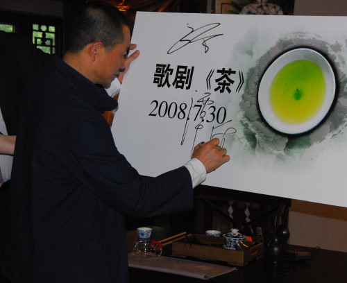

# 演绎因茶而生的爱情故事

中国和日本都是著名的“茶国”，怎样表达它们茶文化的区别？谭盾归结为一句话“茶令日本人的生活更加艺术化，令中国人的艺术更加生活化”。  
  
由谭盾作曲的歌剧《茶》将于7月30日在国家大剧院首演。谭盾称，《茶》的配乐运用了很多自然声响，他创作的水乐、纸乐、陶乐，以及水琴、陶鼓、纸鼓等乐器都将令观众耳目一新。为让中国版《茶》走向世界，演员们将用英文演唱。住在北京的人们有耳福啦~  
  
不过谭盾也说，他以前虽然喜欢喝茶，但其实不会喝，直到后来创作歌剧《茶》时，才对茶有了更多了解、认识和感悟，喝茶的观念发生了转变，才知道了喝茶的真正意味。谭盾说，歌剧《茶》是借唐代的关于茶的故事来说茶道、说男女、说生死、说未来。看来谭盾念的“茶经”，已不止是关乎茶或茶道，更是借茶抒怀言事传情说爱了。  
  
[**谭盾歌剧《茶》7月底将登上国家大剧院**](http://www.zgyspp.com/Article/ShowArticle.asp?ArticleID=11338)  
[**谭盾感谢的两只“老虎”**](http://www.shav.com.cn/music/bkview.asp?bkid=25285&cid=43147)  
[**谭盾自曝与太太一见钟情**](http://phtv.ifeng.com/program/lyyy/xxz/200704/0414_1619_102827.shtml)   

