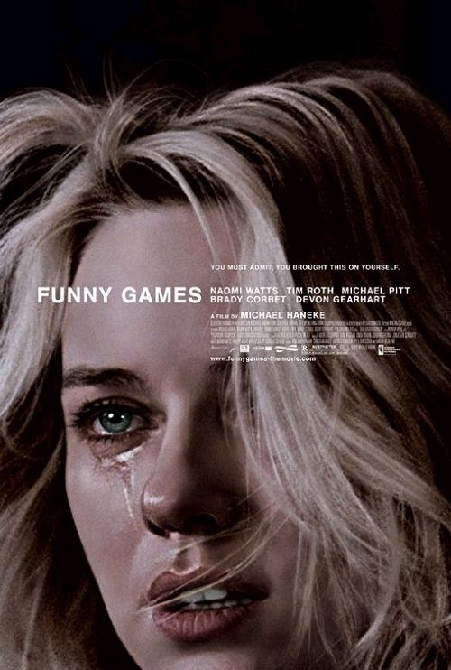

# 离经叛道、道德沦丧：《Funny Games》

如果来得及晚上睡觉前会看一部电影，渐渐习惯了12点睡觉7：30起床的作息时间。  
昨晚看的是[**《Funny Games》**](http://lib.verycd.com/2008/04/12/0000185702.html)，老片新拍，女主角是出演《金刚》的Naomi Watts，导演是Michael Haneke。  
  
  
  
围绕着一片湖水是许多有钱人郊外的度假别墅。  
  
Georg一家三口来到郊区湖边的房子里度假。  
两位白衣年轻男孩Paul和Peter，戴着白手套，彬彬有礼，连说话的方式也是那么斯文。那两张男孩的脸至今想起来仍然耿耿于怀、不寒而栗！温文而雅、彬彬有礼，象是家境富裕的孩子，有着良好的教育，礼貌的走进陌生人的房子......  
  
Paul和Peter犹如做游戏一样杀害了Georg一家三口。象是阅读一本书、看一场电影、打电玩一般轻松自然，充满乐趣。所谓的Funny Games自然是他们二人的“Funny Games”。  
是Georg三口之家最后的假期。  
  
Paul绘声绘色的向受害人一家陈述Peter凄惨的身世，正如大部分影片一样把恶魔的变态行径归咎于童年不幸了事。还有小船上匕首的设计。影片之前专门给了它一个特写，我本以为这把匕首可以帮助Georg一家脱离险境，电影恰恰没有按照传统模式进行而是反其道行之：Paul有着良好的家庭，最后的希望“匕首”也轻描淡写地被丢到了湖里。正义没有战胜邪恶，好人没有打败坏人，影片导演Haneke强行灌输给你的，可这个“强行”却到了霸道、完全不讲人性的地步，这是一部具有强迫症的电影，令人感到不适。  
  
让人心有余悸的是我们该如何防备现实生活中正常面孔下心理扭曲的人？  
尤其是所谓的“精英”中恰恰变态的不在少数，夸夸其谈着真理、真爱、正义，实则象Paul和Peter一样离经叛道、道德沦丧，精神分裂的一种。

---

## 评论（4）

**coco** · 2008-07-16

最好别在临睡前看这种恐怖片.

**It's min** · 2008-07-16

“如何防备现实生活中正常面孔下心理扭曲的人？  
“  
无解。上帝保佑吧。

**okdata** · 2008-07-16

“精英”的变态，因为精英原本就是大众中的典型  
远离吧

Nice picture，could you send me a copy?  
Thanks

**Christina** · 2008-07-17

这位大叔，千差万别的还不止于思维~

