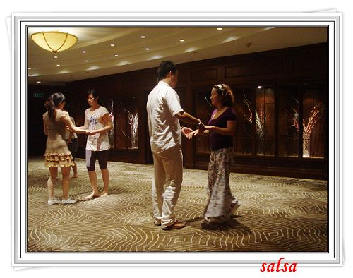
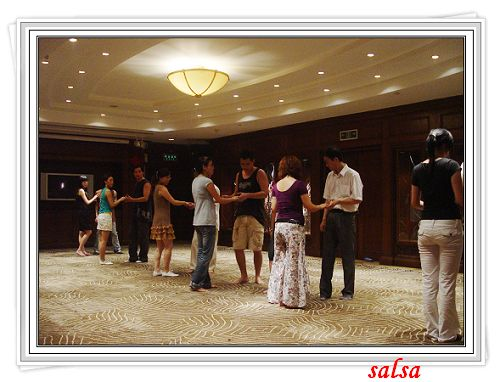

# 跳舞让人快乐~

  
  
  
今天下班去观摩了salsa舞的培训班。忍不住跟着跳了3、4个小时，穿着高根鞋哦：P  
老师说我跳的蛮有感觉，以前学舞蹈整个身体的感觉是“提”起来向上的，泛泛研究了一下Salsa舞，发现得把臀部沉下去，重心是低的，我必须放弃以前跳舞的习惯，让自己松弛松弛再松弛。班上的学员挺开朗有趣，有点象家庭聚会，对于改善心情有帮助。比起机械性的健美操，我更爱这种能让个人情绪、气质和表现力得到自由发挥的运动！在自由发挥这种舞蹈之前必须熟练掌握基本舞步。我认为我可以直接进中级班了，哈哈~还有，再胖一些，最好有个2.2尺的腰围。  
  
听学员们说每周五南京有个酒吧专门举办Salsa舞party，外地也会有爱好者涌到这里参加。学员中年龄最大的40多岁，最小的十几岁，看到一群人为了同样的爱好聚在一起，学得那么认真，我有点儿被触动。描绘人生色彩需要的就是这样的精神吧？！  
  
Salsa定义起来并不是那么简单。是谁最先创出了Salsa?是古巴人，还是波多黎哥人？Salsa吸取了多种拉丁舞以及非洲和加勒比舞风的精华，其中每一种舞风都在Salsa的形成发展过程中起到了很大的作用。  
  
Salsa和曼波有相似之处，它们的风格都是每八拍走六步。舞者大部分的步调都是一致的。在Salsa中，扭动是一个很重要的特点，所以从整个舞姿外表看来，它与曼波还是有很大的不同。  
  
分享一段精彩的Salsa舞：  
[**http://6.cn/watch/3337938.html**](http://6.cn/watch/3337938.html)  
  
视频中的NANA正是今天在班上遇到的女孩，她学了8个月的Salsa舞，跳的不错吧：  
[**http://6.cn/watch/5178710.html**](http://6.cn/watch/5178710.html)  
  
salsa party：  
[**http://6.cn/watch/4604889.html**](http://6.cn/watch/4604889.html)  
  
2006 Salsa Congress ：  
[**http://6.cn/watch/4715160.html**](http://6.cn/watch/4715160.html)  
  
Bachata舞，目前南京还没有教授的老师：  
[**http://6.cn/watch/4672430.html**](http://6.cn/watch/4672430.html)  
  
有关salsa舞的风格有多种不同的描述，比如它们发源于何处以及有何独特之处，salsa有洛杉矶风格，纽约风格，迈阿密风格，Cumbia风格，古巴风格的salsa舞。目前我还不能区分各个舞风之间的差异。

---

## 评论（6）

**itsmin** · 2008-08-14

跳舞会让人快乐起来的。Enjoy!

**coco** · 2008-08-14

视频,第一段:美!第二段:“泛泛研究了一下Salsa舞，发现得把臀部沉下去，重心是低的”,马爱噶得,搞滴不好会不会也那样肥臀下垂啊?……最后一段:一定要叫上老公一起跳哦,呵呵.昨天和朋友说我要去学salsa舞,问,会不会成妖怪啊?哈哈

**绿恐龙** · 2008-08-14

bachata 一定不会是老公 但是又不是一般人。。

**[薇安](http://www.bulaoge.com/?vivianxu)** · 2008-08-14

你有舞蹈基础肯定学起来快的

**Christina** · 2008-08-14

不同人看同一件事还真是角度不同.  
如果男女生跳舞一定与暧昧有关,天下的舞蹈演员都别跳舞了!

**CAICAI** · 2008-08-14

看了视频，不太喜欢。

