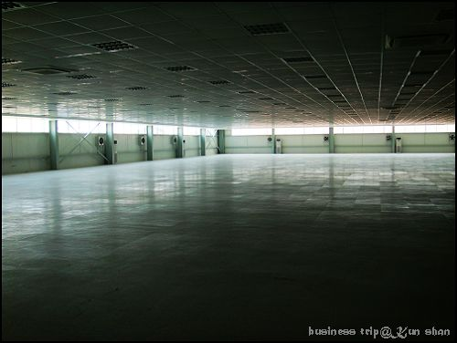
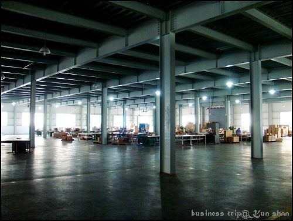
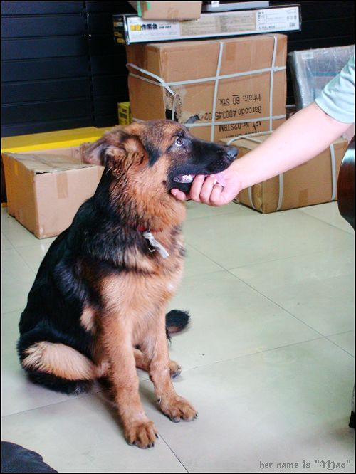
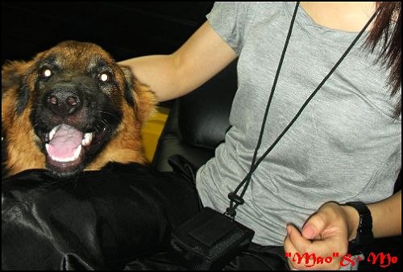
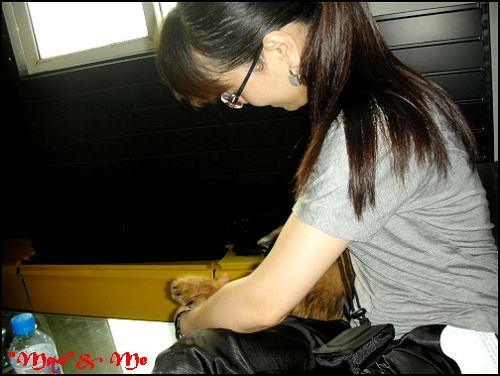

# Dear 毛

狗狗的名字叫“毛”，很奇怪的名字，是不是？  
是公司仓库的狗，6个月大。刚从军犬队来的时候只有2个月大，浑身肉嘟嘟的，很可爱。  
给她喂水喝，她很开心，喝完之后上来就扑我，爪子在我的裤子上摩擦出“沙沙”的声音。  
自从妞妞在父母家被偷走后，一直还想有条可爱的狗狗。  
   
   
   
   

---

## 评论（4）

**itsmin** · 2008-08-20

呀，有狗狗啦？

**abidingstar** · 2008-08-20

我也喜欢狗,我们家养了一只,全黑的.

**[Catherine](http://forucy.blogcn.com)** · 2008-08-21

昆山好.偶家就在昆山.

**Christina** · 2008-08-21

公司仓库的狗，叫“毛”。

