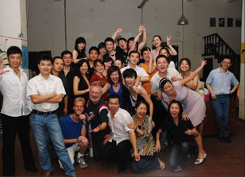
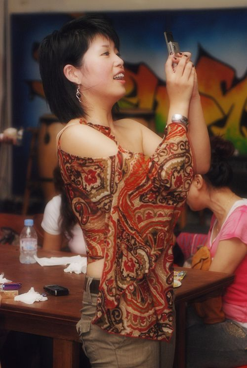
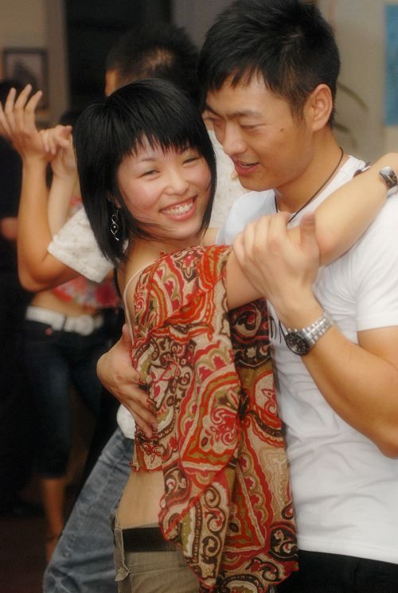
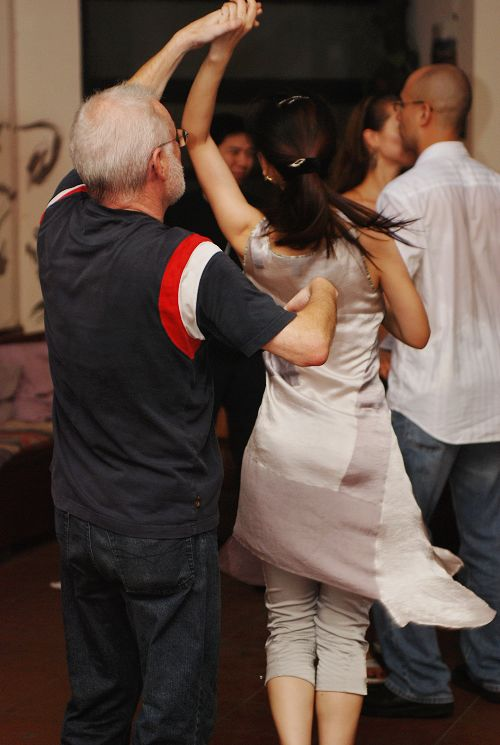
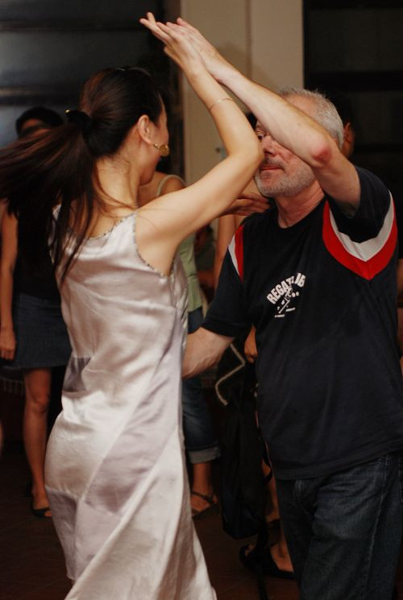
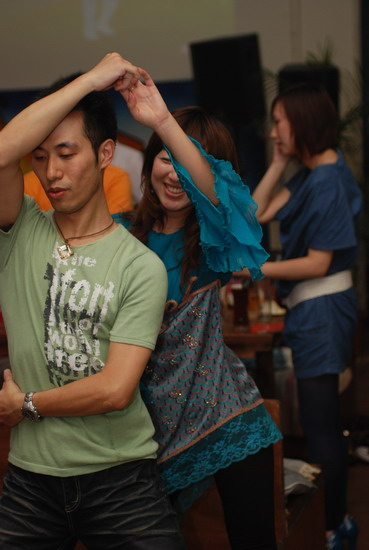
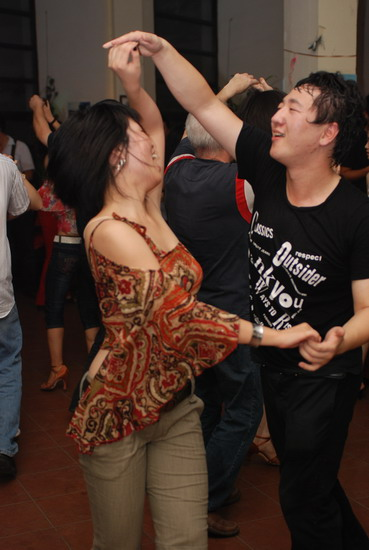
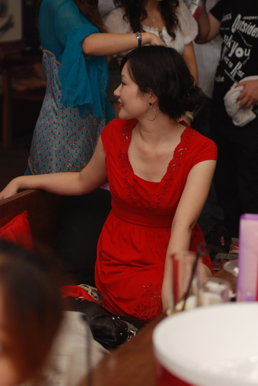
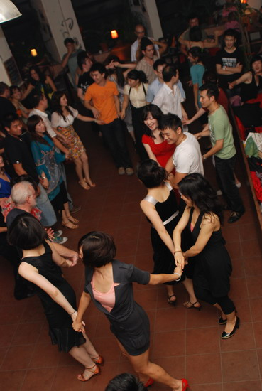
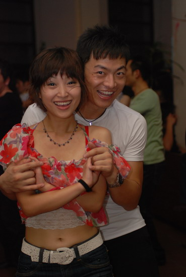

# salsa的周末

星期五salsa舞学习班上的5个人集体过生日，邀请Sherry和我一起去。  
  
开始时完全忘记课堂上学习的舞步，犹豫地挪动了几下便呆掉了。看来想要在实践中游刃有余发挥出来，真没有近路可走，必须脚踏实地的刻苦学习。自从参加了salsa舞的学习，生活中我也变化不少，变得快乐，明白妥协的意义！我在考虑是否剪掉长发？因为旋转时会打到别人的脸上。那晚不仅被别的女生的高跟鞋踩了几脚，我也踩了别人好几次，呵呵~离开party时我的衣服都被汗水浸湿了，玩得非常开心，开心得有些奢侈~  
  
吃过亏的人，在最初交往时会自己先筑下一道厚厚的墙，可在salsa舞的集体中，自己会先推倒这堵墙，周围人真诚而热情，那么，为何要将自己围在墙的这边呢？人和人，本来就应该这样交往，不是吗？  
  
祝大家中秋快乐！  
  
@集体照@  
   
  
\*这是我们非常可爱而智慧的老师\*  
  
  
#老师和她的学员共舞#   
   
  
下面两张是我在跳舞哦~舞伴是来自法国的工程师，在南京工作三年，他所在的公司在世界各地有合作的工厂。老人的名字始终说不顺口，也写不下来，也是我们班上的学员。课堂上和他做过舞伴儿，当时没发觉他的光彩，然而周末的party却和这位老人配合的不错，更确切地说是在他的带领下我还能跳得不错。但是在一次旋转中我居然将他呈90度的眼镜脚打成了180度，他轻轻一折又回到了90度：P变魔术似的，呵呵~所以，不要以貌取人哦！  
   
  
  
舞动瞬间~美女好多呀~  
这个黑红搭配的女生学习了8个月salsa，跳得非常好了！  
  
  
世界真小，体恤男生居然是Sherry的高中同学；  
  
  
老师和上海来的Alan的salsa真是看得人眼花缭乱；  
  
  
Sherry是不是变化很大？越来越有女人味：P  
瞧，旁边居然有人拿着毛巾擦汗！  
  
  
生日高潮部分，大家围成一个圈一起跳舞，而我在边上象高手学习salsa；  
  
  
这个女生也是我们班上的高材生。  

---

## 评论（11）

**[nokia2100™](http://www.douban.com/people/nokia2100/)** · 2008-09-14

Happy the Mid-Autumn Festival to Chinese Tea!@

**michelle** · 2008-09-14

it reminded me of “Shall We Dance”. brilliant! just into it and have fun!

**Xiaona Wang** · 2008-09-14

So admire it! It must be so much fun!

**itsmin** · 2008-09-15

一个快乐的人群。Enjoy!

**[asiapan](http://asiapan.cn)** · 2008-09-15

舞蹈老师和黑红美女的衣服样式好性感哦，漂亮啊

**[光光](http://gaoguangguang.blogbus.com)** · 2008-09-16

照得很好哦。

**lilian** · 2008-09-17

我也想学…

**lusfe** · 2008-09-18

哪里学的呀？

**seawolf** · 2008-09-19

挺好的，老师很可爱！

**车安真** · 2008-09-22

美女真多 羡慕你的生活 想南京～

**[samba](http://www.salsa-nanjing.com)** · 2008-09-27

对于那法国工程师GILDAS的折眼睛技术，我想声明多半是在我们的PARTY上造就了现在的魔术师。哈哈哈。

给了我特为感性的BLOG。也许回头写我就不是那么的疯狂了。  
但跳舞依然。：）

