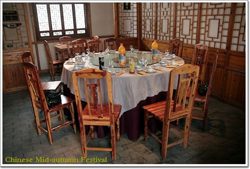
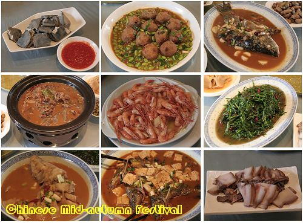
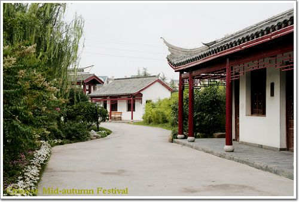
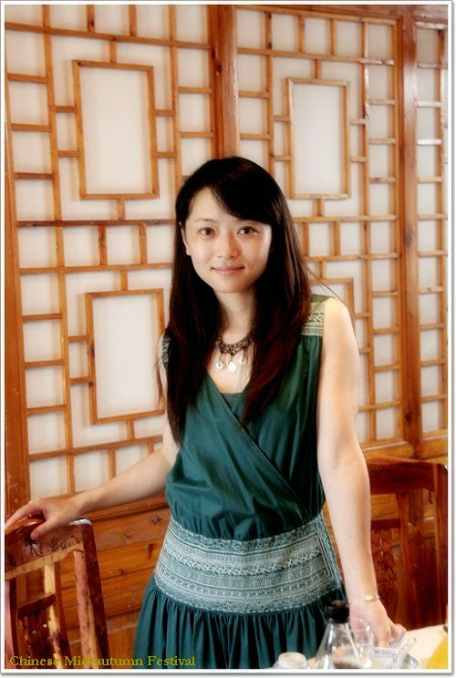
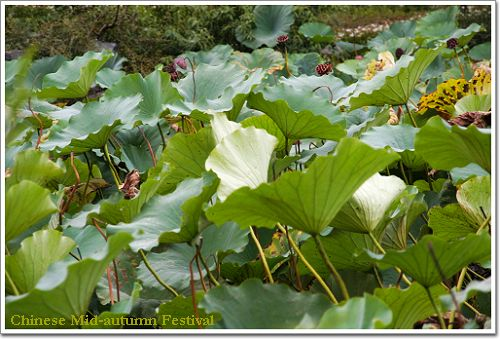
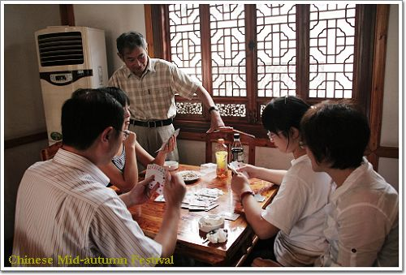
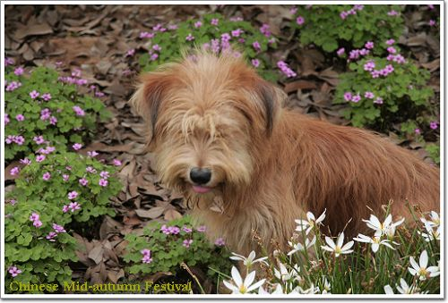
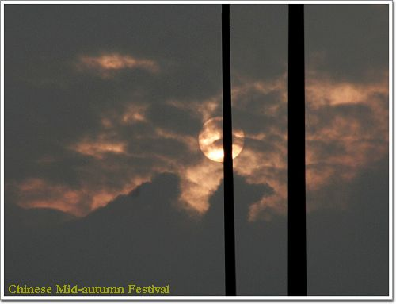

# 中秋佳节

农家小院，so....远，湖熟，听说过吧？  
  
  
吃鱼为主，所以点了三份鱼；  
  
  
古色古香的小院子；  
  
  
家里人接受不了先前穿的粉红色连衣裙，这就换成绿色的啦~   
  
  
今年夏天一张荷叶的PP都没拍，秋天补一张；  
  
  
饭后，一家人打起争上游；  
  
  
它在丛中笑~  
  
  
回家路上拍下的月亮？太阳？  

---

## 评论（4）

**michelle** · 2008-09-15

That’s all about harmonious life, a much more admirable scenario in the earth than that on the moon!

**itsmin** · 2008-09-15

快乐中秋！

**S** · 2008-09-16

Have been reading your blog for a while. Really enjoy it. You are a pretty and elegant girl with a sensitive and kind heart. All best wishes:)

**Xiaona Wang** · 2008-09-18

那一桌节日佳肴真令我垂涎三尺！

