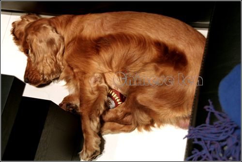
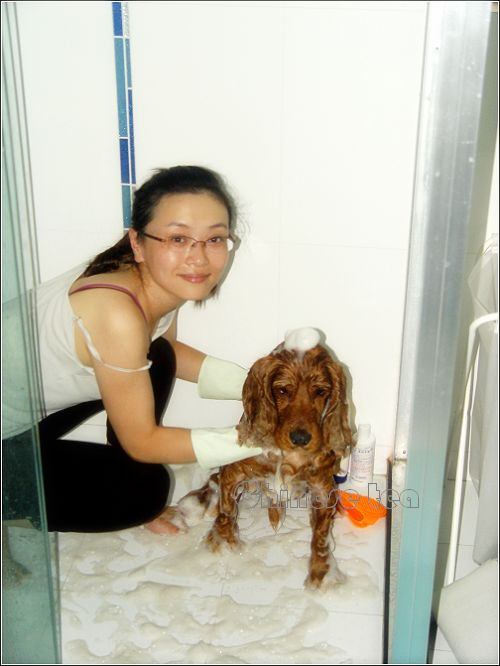

# 洗。澡。快。乐。

Luke怀抱着它的玩具睡着了。  
   
  
洗澡的Luke非常配合。  

---

## 评论（9）

**[Proke](http://www.zhoutian.name)** · 2008-10-03

不管大狗小狗，一洗澡就都成腊肠了。

**[yanglei](http://www.yanglei.name)** · 2008-10-03

哈哈，笑坏我了，给正在洗澡的狗狗拍照，你有没有发现它那表情很无奈呀…

**baliang82** · 2008-10-03

可爱的狗狗，洗澡洗得有点夸张，到处都是泡沫。呵呵

**zhuyuxan** · 2008-10-04

今天心血来潮，搜索“中国茶”，竟然发现“茶”还在更新。6年了，我从大学生，到找工作，换工作，换城市，换女友，买房子一路过来，感叹岁月蹉跎。回想起刚来“茶”上看的小说《跨越身体的国境线》时的情怀，现在只会担心完成不了银行任务会被炒，担心买的房子发展商会出问题，担心经济还是这么糟糕，担心的问题有太多！有句话“尽人事，听天命”，可我依旧忧心….

**Xiaona Wang** · 2008-10-04

Luke掉毛很厉害吗？除了常洗澡，平时您怎么打理他的长毛？

**大姜炖去** · 2008-10-04

我最怕刚给狗狗洗完澡  
它就站起来抖毛

**Christina** · 2008-10-04

6年，不长不短，我也发生了很多变化~

Luke背上的毛是剔掉的，掉毛现象还好啦。

Luke也喜欢抖毛，尤其是在茶几附近，你正喝着热茶，它忽然浑身上下的抖毛，叫人郁闷~

**Michael** · 2008-10-06

我养来看门的狗被大客车给…  
看着平时活蹦乱跳的它被放在了一只水桶里…

**邃** · 2008-10-07

一直都在关注茶，只是没有想着去留言什么的，就像一个神交已久的朋友，远远看着就觉得满足了！祝福“茶”越走越远！

