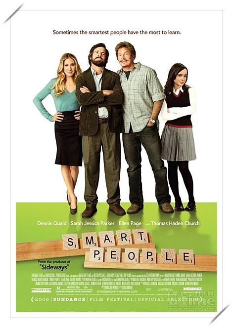

# 《Smart People》

  
  
丹尼斯·奎德和萨拉·杰西卡·帕克饰演的男女主角，这两位我都喜欢。  
配角演技也不赖，艾伦·佩吉和托马斯·海登·丘奇饰演侄女和叔叔，叔侄搭配的“老少对”在影片中甚至给人印象更为深刻。  
  
艾伦·佩吉说的一句台词：“你看某某修女，不是怀抱弃婴，就是搀扶着满脸褶子的老妇人，那是因为她的SAT考试只有中下成绩。象我们这样的社会精英，不用以这样的方式来补偿社会。”  
  
IQ高，EQ低，这就是片中所谓的聪明人。  
Sometimes the smartest people have the most to learn.  
  
电影：[**《Smart People》**](http://www.letv.com/film/mm/c/1217520000000/030818631.shtml)

---

## 评论（1）

**[yichuanbaobao](http://yichuanbaobao.spaces.live.com)** · 2008-10-05

很喜欢你这个家园，文字照片都很好，热爱生活，热爱周遭的一切。还有，我也很喜欢狗狗的，Luke很可爱。

