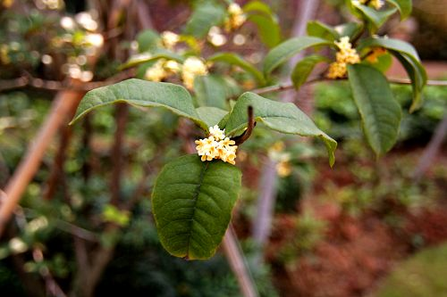
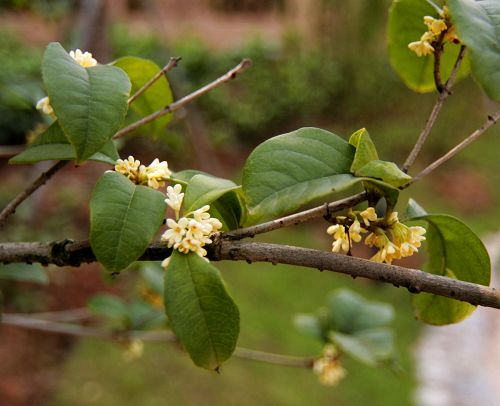

# 满城尽是桂花香

没有比这个季节的凉爽更舒服的感觉了。  
夜晚空气中熟悉的味道可以一次又一次将我带回到从前。  
  
   

---

## 评论（3）

**coco** · 2008-10-07

“没有比这个季节的凉爽更舒服的感觉了。”……上午抬头见到蔚蓝的天空,和煦的阳光,唉!多么希望自己是正在驾车出游而非去上班.

**[yichuanbaobao](http://yichuanbaobao.spaces.live.com)** · 2008-10-08

我也很喜欢秋天，带来很多回忆

**Sam** · 2008-10-16

喜欢桂花，从喜欢郁达夫的《迟桂花》开始。  
“桂花开得愈迟愈好，因为开得迟，所以经得日子久。”

