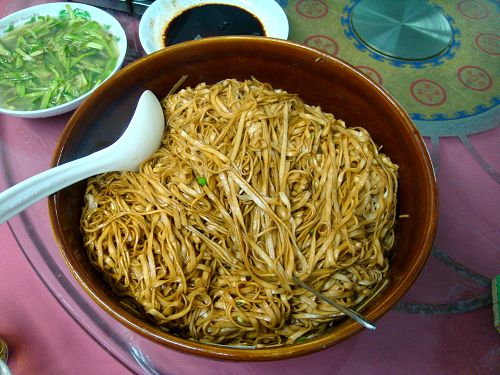
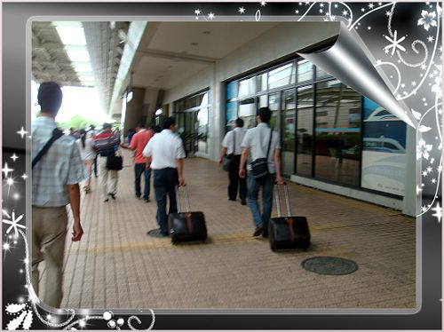
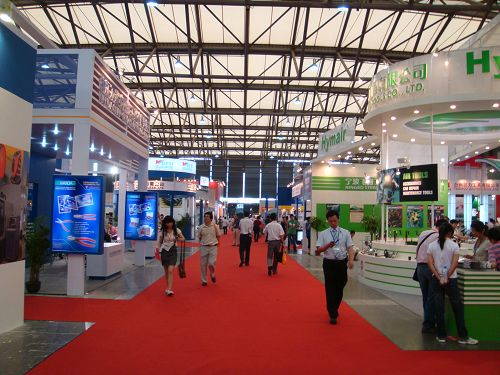
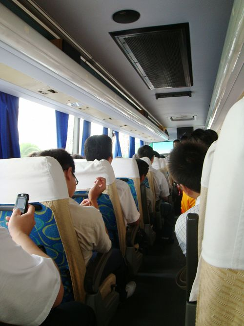
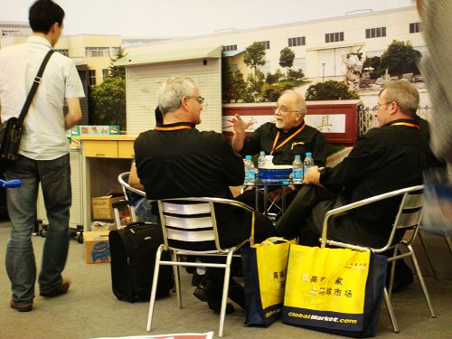
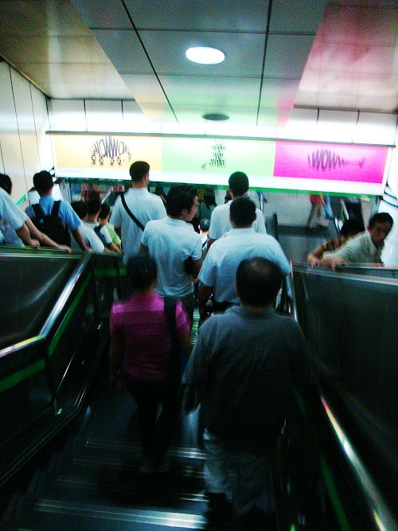

# 出差。

又是一整天的出差。  
早晨7：10闹铃响，再眯一会儿吧，一睁眼7：52分，以最快的速度出门，到了公司已经8：10分。干了一天的活，脖子上粘乎乎的满是汗渍。这次出差虽然累，但很愉快。  
  
路上和同事海聊，人，真不可貌相，平时看起来惯宝宝的80后，居然会做很多菜，自己打扫卫生，有些轻微的洁癖。现在会做家务的年轻人少，况且还是80后的男士。和有轻微洁癖的人生活在一起，另一方必会感到压抑。洁癖的一方也会不爽。以前看到地上有点脏就要动手弄干净，喜欢家里整整洁洁，事实上那样自己会很累，但又很难忽略。发展到后来可以睁只眼闭只眼过日子了，这才少许轻松。洁癖是和自己过不去，追求完美，也是强迫症的一种。应该属于心理问题吧？  
  
拌面，海碗。面条里加了蛋清，不腻口，味道不错。  
接待的人带了两只农夫山泉的塑料瓶，里面盛着深黄色液体。说是酿造了9年的药酒，人家拿五粮液跟他换，他都不答应。这酒是用三年酿造的米酒，之后加入中草药，放置6年。酒水有挂杯现象，第一口下去很冲，几秒钟食道有燃烧感，热。第二口第三口...便适应了，50度以上酒精含量。这种用很多年酿造的酒越来越少，市场需求大，快餐效应，五粮液也没这个口感醇。当然我是极少喝白酒滴。我哥和我姐夫国庆期间打开两瓶五粮液，第一瓶白开水味道，第二瓶辣嗓子...政府是不是也应对酒水市场做一次全面的检测呢？  
  
  
9月出差时拍的。   
  
   
   
   

---

## 评论（5）

**[samba](http://www.salsa-nanjing.com)** · 2008-10-10

其实很佩服你能一边拿行李一边那相机拍照。  
莫非行李都让同行的男人们拿了？！

**lilian** · 2008-10-10

我也很佩服。尤其喜欢这种视觉日记的形式，贴几幅相片比仅有文字生动多了。

**eeiivv** · 2008-10-10

好久没有消息了啊，呵呵，还记得我吗？

**Christina** · 2008-10-10

我的男同事们可没那么绅士~如果出差行李也需要别人照顾的话，看来男女真的有“别”了~

**Sam** · 2008-10-16

CIHS 08? 是的话可惜了…

