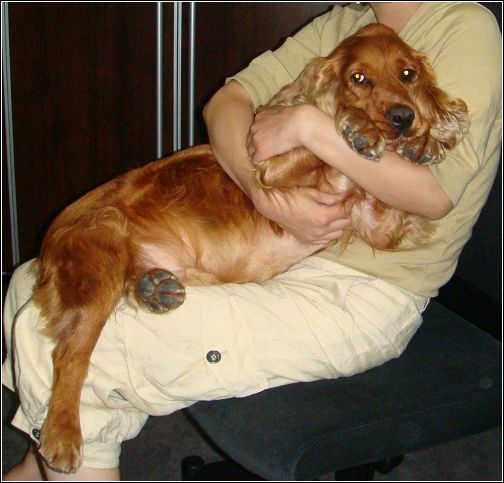
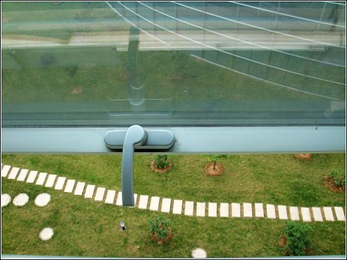
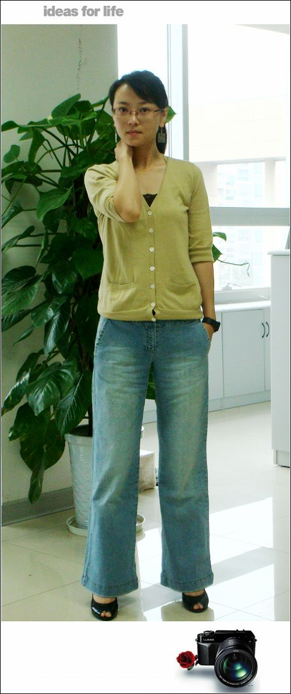

# Ideas for life.

我抱着的是一头小猪：D  
抱着他可不容易哦，14.7KGS呢，最大的爱好就是吃和睡。  
   
   

---

## 评论（12）

**[samba](http://www.salsa-nanjing.com)** · 2008-10-21

看，没了SALSA的2个礼拜，开始严肃了。：）

**Michael** · 2008-10-22

很C~~O~~O~~L

**星星** · 2008-10-22

不错不错

**灰子** · 2008-10-22

看上去瘦啦

**Christina** · 2008-10-23

是的，瘦啦！  
也许和头发扎起来有关，披下来显脸大，扎起来正好。

**淡蓝色** · 2008-10-23

这条裤子太好看了。赞一个！

**大姜炖去** · 2008-10-23

第三张的拍摄角度很有意思  
看了半天才看懂，我很笨……

**Christina** · 2008-10-23

裤子改短了，但改的有点短，再长些就好了，是韩国的一个品牌，4年前买的。以前和一件中袖淡蓝色紧身上衣搭配比这件上衣搭配效果要好。这样搭配太素。

**MAGGIE** · 2008-10-24

呵呵，不是裤子改短了，是你最近练舞，长高了！

**lilian** · 2008-10-24

头发梳起来最好不要戴眼镜,五官被镜框遮得都看不清啦．

**Christina** · 2008-10-24

舞里看花，更朦胧~嘿嘿~

**mandy** · 2008-10-29

喜欢这头“小猪”真想抱抱它~~

