# 苏州。东山。西山

在东山、西山开会，顺便游览。  
  
东山三面临太湖一面临山，在东山有许多果树，虽然摘橘子的过程有点搞笑，但算是体会了点农家“乐”。西山四面被太湖水环绕的小岛，据说面积有香港那么大。在西山游览了两个景点：天下第九洞和石公山。有空可以去东山西山度周末，至于景点我认为不是必须去看的。  
  
在那里每日正餐一定是太湖“三白”，鸡汤、水芹、笋干烧红烧肉、螃蟹、莼菜汤、白斩鸡....每日如此，苏州属那种菜系？即使每天菜肴品种差不多，我还是对东山西山渐渐有了好感，撇开景点不说，行进在路途中看着太湖边上娇艳的红月季花，在芦苇荡背景下甚是好看，满眼江南风光，一点不做作。  
  
摄影是一件需要热情和激情的去做的事，摄影需要独自思考。  
摄影的原始动力可以是热爱生活，可以是对美的追逐，可以是钻研机械理论的兴趣，也可以是很爱很爱一个人。TA才能够孜孜不倦地捧着相机...  
  
三春茶叶四月梅，红枣蜜桃喜相连；  
初夏端阳枇杷熟，夏至杨梅满山甜；  
五月李子挂满树，花红采摘七月间；  
石榴大，葡萄鲜，银杏板栗赶秋天；  
雪柿红时蟹橙黄，洞庭桔红霜降边。  
  
我拍摄的东山：  
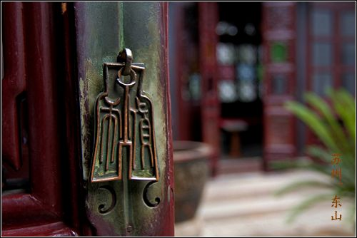   
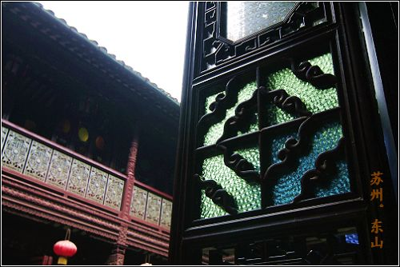   
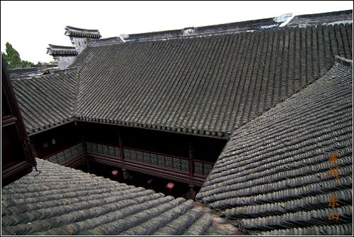   
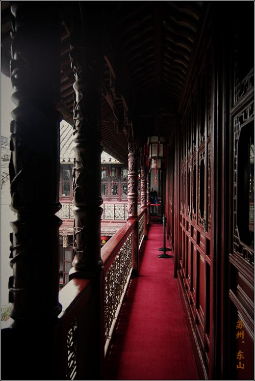   
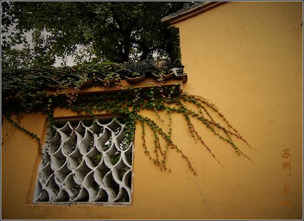   
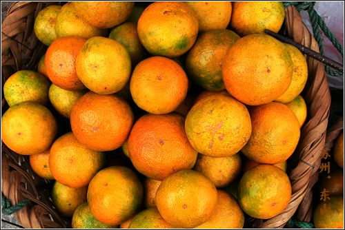   
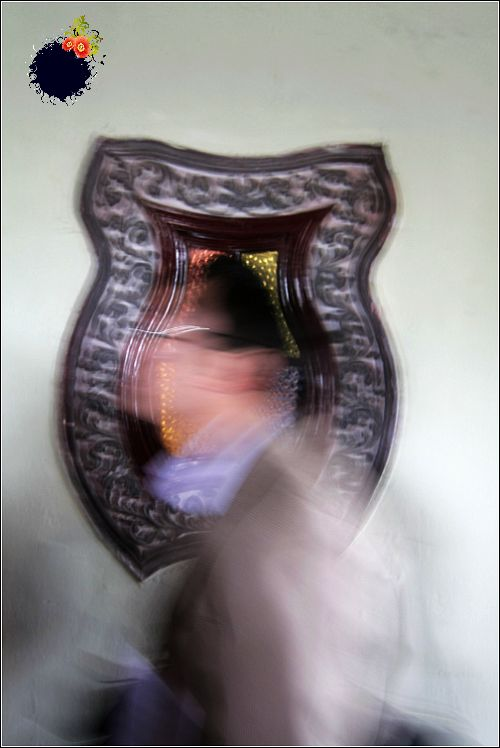   
  
同事拍摄的，遗憾的是很多曝光过头了~  
   
   
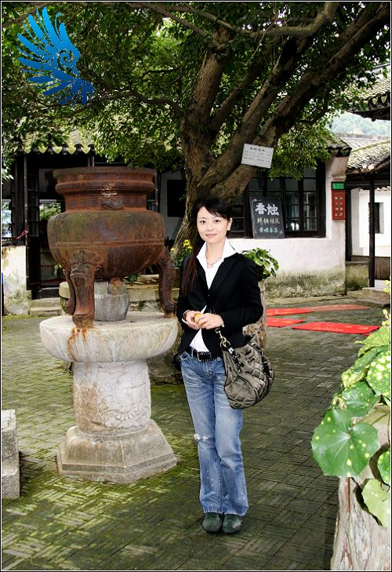   
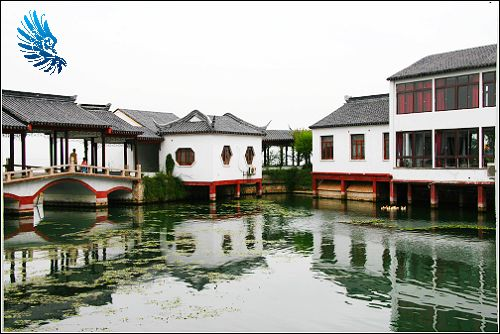   
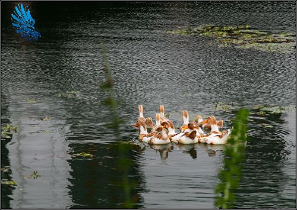   
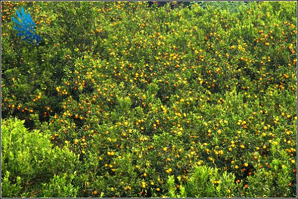   
  
来张开怀畅饮滴。  
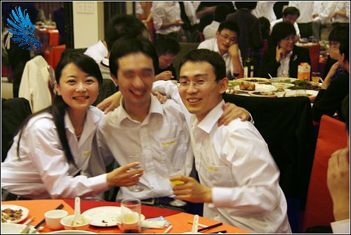   
  
这是我们公司一个供货商的大别墅，900多平米。据说是90年代在太湖边上买的地自己盖的，现在要买土地，必须要当地户口才行，貌似现在的宅基地。他让家装设计师和他住了两个月，了解他的生活起居习惯后再帮他设计。他生活工作在苏州的木犊，周末过来住。找了村里的一对老夫妻帮忙打理大屋的卫生、照顾一小块菜园，每月给他们2000元人民币。大屋用的是长虹、海信电视，音响也是很一般的国产品牌，大屋正面对太湖，风景很好。在小地方的好处是土财主可以花较少的钱拥有貌似富豪的生活。有人说：人一生拥有1000万人民币（国内）就足够了，之后再多个零，生活本质上也不会有太多差别。  
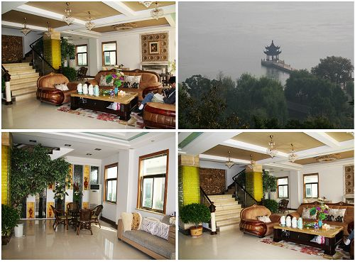   
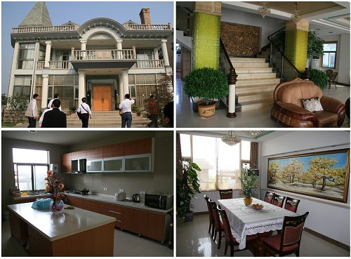

---

## 评论（19）

**lldt** · 2008-10-28

哇，全是好吃的

**lldt** · 2008-10-28

奇怪，你的下一篇日志怎么无法访问？

**itsmin** · 2008-10-28

谁把苏杭曲子讴，荷花十里桂三秋。:+)

**[Catherine](http://forucy.blogcn.com)** · 2008-10-28

啊…….桔子……….

**[shenwen](http://shenwensw.blogbus.com/)** · 2008-10-28

秋日阳光下的太湖会泛着海一般的蓝色，但是比后者来得宁静细致，当然还有大片绝美的芦苇群。兴许这是江南除了小格局里的天地之外，宽阔留白的地方。

**Michael** · 2008-10-28

最后一张表情不错

**Cindy** · 2008-10-28

感觉楼主胖了一点点，不会是准备怀宝宝了吧。。。瞎猜的。。。呵呵

**Christina** · 2008-10-28

恰恰相反，瘦了好多。  
照片会显得比本人胖，现实中我没有照片看上去那么圆。

**大湖** · 2008-10-28

Speaking of 太湖 西山, my Dad was a schoolteacher there in the 50’s. The class was held inside an old temple. Back then, there were no bridges, no cars, and no electricity on the island, just beautiful views everywhere you look and lots and lots 枇杷 trees. I’d like to visit there someday.

**Christina** · 2008-10-29

欢迎回来！  
东山没有什么污染企业，看着那么清绿的水面（小河水），我真感到兴奋！

**Michael** · 2008-10-29

一标准化厂房也不过才1000-2000.房子太大就缺少人气了…

**yellowstone** · 2008-10-30

所谓的豪宅，还不如美国中上产阶级的房子。我的房子都比这个豪宅强十倍。

**Christina** · 2008-10-30

这是在农村啊，要不怎么说是“土财主“呢~  
美国中产阶级和我们中国农村富豪攀比，中国农民会感到很荣幸滴~

**大湖** · 2008-10-31

Do not believe him, Christine. “Ten times better” is groundless and a far stretch comparison.  
How many “middle class” American families can afford a 900-sq. meter house with a lake view? Also, how many “middle class” American families can afford 2nd weekend retreat home and hire a housekeeper?

I would assume this “mansion” was designed and built a quite few years ago. Back than, the designing experience and the construction material selections were very limited to the Chinese designers.

For example, in USA, for the brick along, you would have 60+ choices based up on the size, color, and the textures of the brick. Why I know this? Because I’m building our new home now and we just went through this selection process.

**yellowstone** · 2008-10-31

也许你不信，美国一般城市的HOUSE相比北京上海应该便宜很多，在美国一般城市比较好的学区６０－７０万美元应该能买到不错的３０００－４０００SQ FEET SINGLE FAMILY HOUSE，LOT ０。５ ACRE，而在美国中国移民两人工作，年收入２０万美元左右，供一栋房子问题不大，我们小区是最好的中产阶级的，３００多户有３０多户中国移民，小区是沿着GOLF球场建的。我朋友有VACATION HOUSE的人很多，VACATION HOUSE又不是很贵。当然也有贵的，我们在美国也就是一般的PROFESSIONAL，和其他大多数中国人差不多。在美国拥有VACATION HOUSE不应该是很困难的事情吧.

**Christina** · 2008-10-31

在中国买栋“大屋”也不难，就是看你买的房子离市中心距离远近了。

南京江宁区的联排别墅都已经超1万CNY/每平米，还有比江宁更远的别墅，价格也不便宜，还有比这更…更远的，比如溧水县城、句容等等，虽然一小时车程可以到达，问题是有多少人会选择购买没有周边环境、居住人气不旺、没有配套设施的城乡结合区域呢？

国内消费还是很畸形的，房价和平均收入水平不成正比。但人们还是要购买房产，结婚用，投资用，目的各不相同。在南京有山有水的区域有限，所以在有山有水的边上开发的房产价格一定不菲，空气、自然环境是人们考虑买房的因素之一。在南京花６０－７０万美元在学区好的地段买３０００－４０００SQ FEET SINGLE FAMILY HOUSE，LOT ０是绝对买不到的，江宁山边的一个别墅区里有栋带游泳池的“楼王”，前年的总价格要2000多万人民币。周边相邻的3、5百平米的别墅也要4、500万人民币，那可是真正的VACATION HOUSE，当然也有长期居住的，开车不堵的情况下20分钟可以到达南京的市中心新街口，可想而知国内的房价…..

除了房价，车价也是，我那车在北美卖2.9万美圆左右，在国内裸车价卖32万人民币。由此可见，生活在美国消费支出比在国内低了许多，生活压力也比在国内小。不知道我的看法是否成熟？

**大湖** · 2008-11-01

No offense Yellowstone. You can say You like your house ten times better than that one. However, what you can’t say is your house is ten times better than that one.

Also, I don’t want the readers to be misled by your statement that “middle class” Americans are able to live in a better home than that one.   
According to Christina, that is a 900-sq meter mansion (that is 9684-sq ft, more than twice as big than yours).

If I’m not wrong, only less than 8% American’s household has incomes that is greater that $200K/yr.  
So, congratulations, you have done very well financially.

**yellowstone** · 2008-11-01

国内房子面积计算方法和美国计算方法完全没有可比性，国内７００－８００ M２的房子不如美国３２００ SQ FT 的房子大，美国这边车库和BASEMENT都不算在面积里，THREE CAR GARAGE 加FULL BASEMENT，HIGH－CEILING 至少不比这个房子小，我在北京的高档小区住过，很多没有GARAGE，而且LOT都很小，都号称７００－８００ M２，房子没有美国３２００ SQ FT的大，都在１０００万RMB以上，当然，一般人也住不进去，很多公司老板，歌星。国内的好处是人工便宜，他们都有小时工打扫卫生，餐馆送餐，在美国这些事都得自己干了。

在美国老中收入比绝大多数美国人INCOME高，很简单老中学位高收入也高，我们来美国的时候真能出来的大部分都是名校成绩拔尖的学生，能在美国毕业拿到学位，毕业马上能找到工作的，在目前这种经济形势能SURVIVE的人应该能力都很强。我们小区的老中家庭２０万很平常，基本都是做技术工作的，如果一人做医生，年收入在３０万以上，还有牙医自己有诊所，年收入５０万以上，我有一个朋友家一人是律师，一人是医生。老中中有才能的人确实很多，收入高于美国平均值也是正常的。

**Christina** · 2008-11-01

南京买房子也有送地下室和车库的，还包括院子也不算在面积里。每个房产公司的推销策略不同，所以算面积的方式会不同。但是，大部分房产公司销售时，一般阳台会算到面积里的，按半价计算。少数阳台不算面积，免费送。

