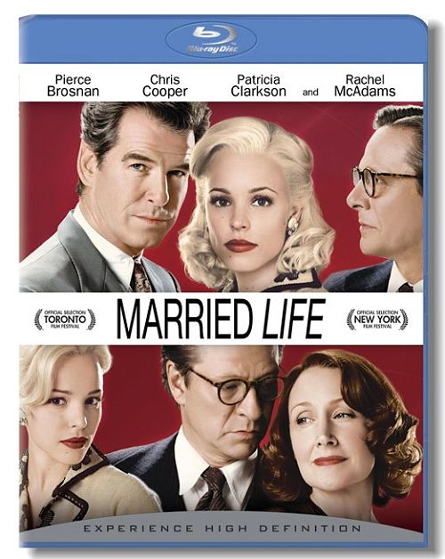

# 讽刺的《Married Life》

这部黑色喜剧只停留在讽刺层面，还可以挖掘得更深一些。  
  
电影中的他们使用各种阴谋诡计，有时候不单单是为了自私的目的，他们也在想方设法地不去伤害到别人。不过都是那么的自以为是，自认为对方没有自己会过不下去、过不好......讽刺的是另一半也这么想，也和自己做着相同的事情。  
  
最让人感到奇怪的是最初声称对婚姻免疫的“花花公子”Richard，最终也无可避免地要结婚。Richard在经历一切的左瞒右骗之后，对婚姻改变观念。  
  
生活中总有一些人把自己扮作正义的使者，指点周围人，好象自己是最最正直纯洁的那个。看过这部片子之后，想一想我们谁有资格去评判别人的生活？你不是也做着同样的事情么，由此可见，那些表情“正义可爱”的面孔是多么具有讽刺意义！  
  
电影既没有挖苦爱情，也没有否定婚姻。却带来一个疑问：既然这样，人们为什么要结婚？  
  

---

## 评论（10）

**[Catherine](http://forucy.blogcn.com)** · 2008-10-30

啊．．．偶一回来就开始被逼着这类问题.  
最近最夸张的一次竟然要偶去相亲一刚！  
偶受不了勒.说了坚决不会去的!！！！！

**宝儿** · 2008-10-30

经常来看你的博客，一直不知道你从事的职业是什么，很好奇。我做影视编导。与你喜欢一样的电影。

**Christina** · 2008-10-30

我是典型的上班族。  
喜欢同样的电影不难，如果穿一样的衣服、喜欢同样的男生可能会比较惊奇哦~

**宝儿** · 2008-10-30

呵呵，衣服我喜欢英伦风格。男人喜欢《白色巨塔》里面的“里见”君类型。很土气吧？呵呵

**[joanna](http://yanmer.cn/blog/)** · 2008-10-30

一直被最后一句话困扰着“既然这样，人们为什么要结婚？”???  
我谈了四年恋爱，为什么就得结婚？朋友告诉我，结婚就是给孩子找个合法的身份。可我现在并未考虑要生孩子

**Christina** · 2008-10-30

好些女人结婚是“病急乱投医”~

我喜欢《天堂阶梯》里的权相佑、《东京爱情故事》里的丸志…这类形象的，小眼睛、眼神温柔，含蓄深沉点儿的男生。也就是闷骚型的，呵呵~

**大姜炖去** · 2008-10-30

小眼睛、眼神温柔，含蓄深沉点儿的男生  
也就是闷骚型的，呵呵

这个好像是宅男类型的……

**lilian** · 2008-10-30

是啊，人为什么要结婚呢？据说五十年之后，人会跟机器人结婚，那是否意味着人人能拥有一位完美的爱人呢，呵呵。。。

**Michael** · 2008-10-31

这些是不是叫文艺片,一般在什么电影节上才会出现的.  
更喜欢音效强的大片

**okdata** · 2008-11-01

嗯~ 什么要结婚?  
1. 合适的时间做恰当的事  
2. 让老人安心  
3. 为了爱  
4. 找原始股二次投胎  
5. 找个保姆  
6. 找张长期饭票  
7. 找个安居之所  
8. 灭火，如蔡琴说的：  
啊~ 寂寞是火  
在我心中 愈积愈多  
啊~ 寂寞是火  
燃烧着我 燃烧着我  
9. 发疯  
10. 。。。。。。。。。。。

