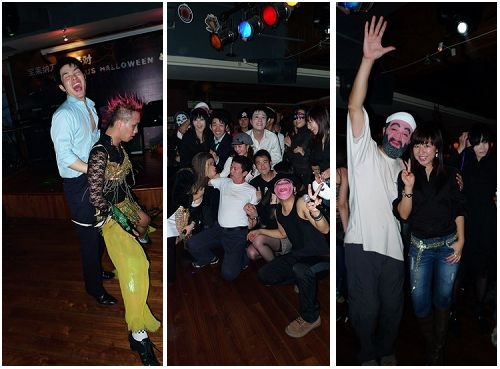
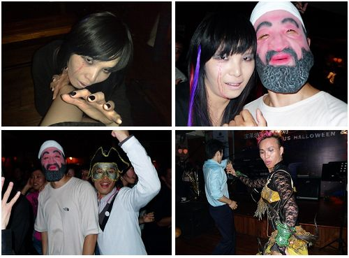
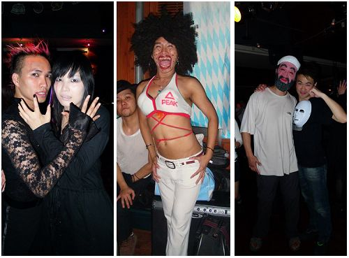
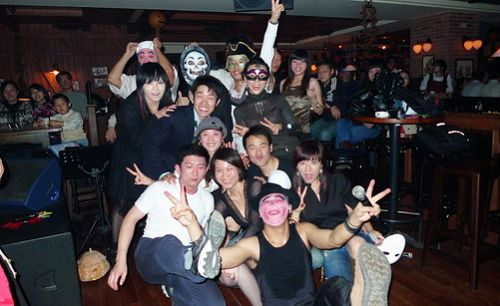
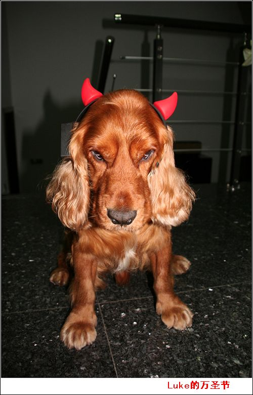
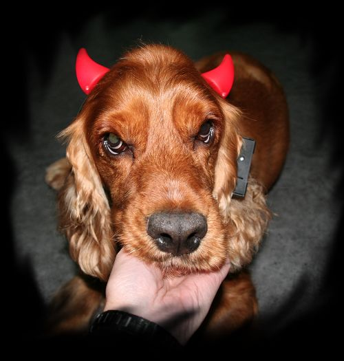
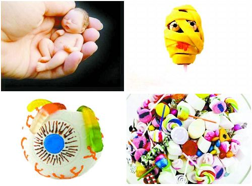

# Trick or treat~

我们salsa班上的同学们多么有趣啊，哈哈~  
  
那个吸血鬼打扮的女孩子就在我公司对面的大厦里工作，salsa跳得很好；拉登摸样的同学已经有40多岁了，是拉丁舞爱好者，他的网名就叫“拉登”，哈哈~还有个嘴巴占据半张脸的性感尤物是位菲律宾男士，是宝莱纳乐队的主唱，他更喜欢男人！平时见了我们班的帅哥都会主动贴上去跳舞，我们都叫他“黄飞鸿”，他的salsa跳得真是出神入化，我喜欢他跳舞的那股劲儿，一点不小姿，完全是奔放型选手。  
  
除了狂欢，还可以在家看碟子，适合Halloween观看的恐怖电影有好几部呢：[**《Monster House》**](http://travel.sina.com.cn/ent/2008-10-28/172833119.shtml)，[**《Shaun of the Dead》**](http://travel.sina.com.cn/ent/2008-10-28/175033141.shtml)，[**《Saw V》**](http://travel.sina.com.cn/ent/2008-10-28/181533147.shtml)，[**《The Shining》**](http://travel.sina.com.cn/ent/2008-10-28/185833154.shtml)，[**《Halloween》**](http://travel.sina.com.cn/ent/2008-10-28/192233155.shtml)。  
  
*这场嘉年华盛会的由来是在公元前五百年时，居住在爱尔兰、苏格兰等地的人们相信，往生人的亡魂会在10月31日这一天回到生前所居住的地方，并在活人的身上找寻生灵，以获得再生的机会。当地居民因为担心鬼魂来夺取自己的生命，故当10月31日到来时，会将所有灯光熄掉，使得鬼魂无法找寻到活人，并打扮成妖魔鬼怪以将鬼魂吓走。  
  
随着时间的流逝，万圣节的意义逐变得含有喜庆的意味。因此现在象征万圣节的妖怪及图画，都变成了可爱又古灵精怪的模样，如番瓜妖怪、巫婆等。喜爱发挥创意的美国人，在这一天则极尽所能的将自己打扮得鬼模鬼样，让鬼节变得趣味多了。*  
  
   
   
   
   
  
我家小宠，哈哈哈哈~那眼神够魔鬼吧？！  
   
  
  
惊悚万圣节，甜蜜吃糖果。  

---

## 评论（5）

**okdata** · 2008-11-01

喜欢本.拉登，哈哈  
不过千万别跟美国鬼子开911的玩笑，这就像外人乱评价我们的512

**itsmin** · 2008-11-01

眼神够魔鬼的…很无奈耶.

**lilian** · 2008-11-03

找不到你哎~

**yellowstone** · 2008-11-04

你们的SALSA CLASS有点SEX CLUB的味道，听说过换妻CLUB吗？ 如果你结婚有孩子了，ALDUT游戏还是不要去碰。

**Christina** · 2008-11-04

您“见多识广”应该更多些包容理解才好。是不是什么人什么想法呢？我们salsa班风气很正的，要不您来体会体会。

