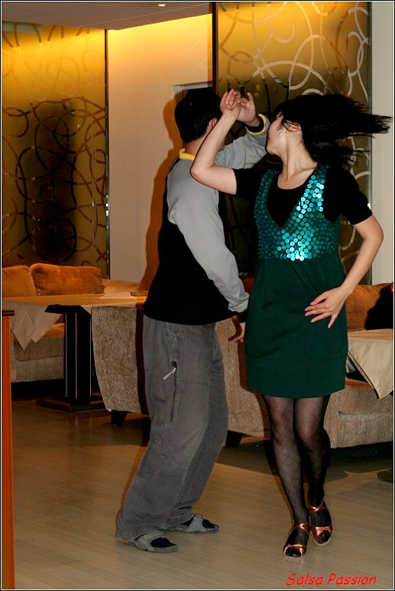
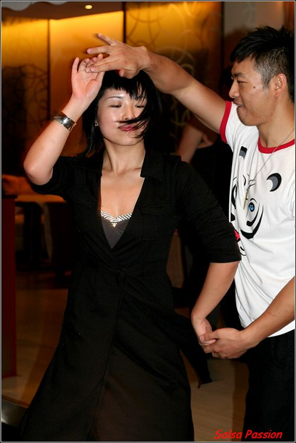
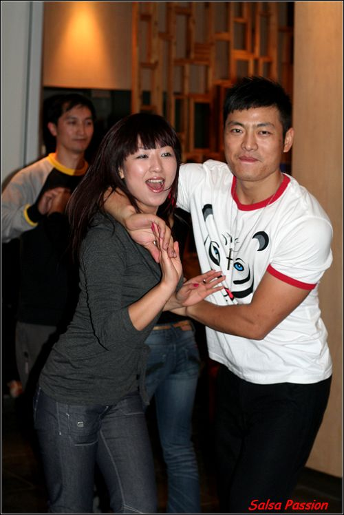
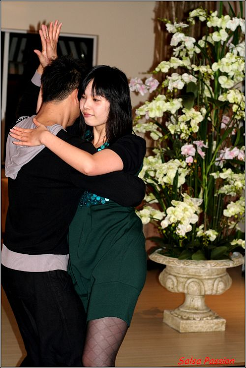

# *Salsa* Passion

理照片的时候发现salsa老学员在舞动过程中的表情大部分时候都表现得很好，想来寻找“美”也是需要过程的，不是吗？  
  
当我们还是salsa初学水平时，光顾着学动作记动作，这一切忙完才会考虑到如何让形体表达的更完美，之后是不是才会照顾到面部表情？！  
  
理照片时还发现跳salsa时间长的同学，很会穿着打扮，一个知道如何表达形体美的人，才会懂得如何穿出适合自己得气质来？！再仔细观察一下女孩子的手形....以前我学习舞蹈的时候，老师总强调让感觉延伸到手指尖。无论做什么事情........细节永远起了关键性的作用，舞蹈更是，缺那么一点，效果差了很多。  
  
那么，我们不仅是在学习salsa，同时也在学习如何表达美！salsa似乎不象专业舞蹈那么挑人，年龄跨度大，从十几岁到六十岁，只要体力尚可，一个月的学习便可以基本掌握简单的舞步，的确比起健身操、机械健身要有趣得多！对平时的生活工作压力也是不错的释放方式！  
  
MORE PIX HERE：[**salsa passion**](http://photo.lifetea.org/v/my+friends/800_001/fei/)(这是近期我拍摄下的画面)， [**salsa before**](http://photo.lifetea.org/v/my+friends/800_001/salsa+before/)(这是salsa班级以前部分活动的照片，我收集到相册里了。)  
  
   
   
   

---

## 评论（8）

**Smily** · 2008-11-12

第3张的GG跟林丹长得挺像；）

**[samba](http://www.salsa-nanjing.com)** · 2008-11-13

其实他更象黄晓明。

**yellowstone** · 2008-11-13

第三张照片的MM很不错，结婚了吗？？？

**Christina** · 2008-11-14

没有，她还小着呢，83、84年的。

**大姜炖去** · 2008-11-14

跳得很有激情

**[abdalla](http://hi.baidu.com/hifey)** · 2008-11-14

倒数第二张的帅哥，手的位置摆放会让人有错觉，哈哈！

**Haliyou** · 2008-11-15

最喜欢第三张照片，MM很有激情。

**sss** · 2008-11-19

总觉得跳舞的男人多些阴柔，少了些阳刚，不大喜欢。

