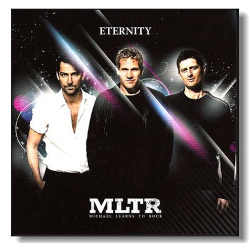

# Shadow Side of Me

歌曲:[**Shadow Side of Me.mp3**](http://filesrv2.nhacdinh.com:8080/files2/mod1/thang10nam08/Michael%20Learns%20to%20Rock_2008Eternity/03.mp3)  
歌手:Michael Learns To Rock(迈克学摇滚)  
专辑：Eternity  
发行日期：2008-10-27  
  
   
  
I feel your existence in your body  
Though you try to hide it  
I know there's a battle in your mind  
  
I'm feeling the distance you are drifting  
And I just can't fight it  
How do we go on like this  
Putting everything at risk  
  
Hard to live  
With the shadow side of me  
You need what I can be  
Holding on  
To a \*\*\* each other man  
If you're looking fot perfection  
That is not the way I am  
  
You say that you love me  
But the future is too hard to promise  
It's making no sense to my head  
  
I know there's a dark side of my spirit  
where you just can't find me  
There is not a sending here  
just a time so who cares  
  
Hard to live  
With the shadow side of me  
You need what I can be  
Holding on  
To a \*\*\* each other man  
If you're looking for perfection  
That is not the way  
  
Hard to live  
With the shadow side of me

---

## 评论（1）

**itsmin** · 2008-11-18

噢, 新专辑?

