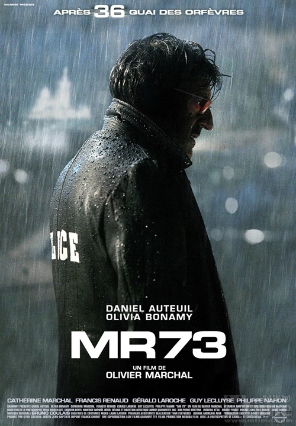

# 也许，我需要一把左轮手枪！

看完[**《MR 73 左轮枪》**](http://www.mtime.com/movie/74631/)怎么也睡不着，接连两部法国片都在告诉观者“这就是生活”的本来面目，我是一个带入感很强的观者，看完之后躺在床上久久的难受。“上帝是个混蛋，总有一天我要杀了他。”路易说这话的时候，正是他忘却自己的时候。在中国普遍缺乏信仰的情况下，却没有上帝可以让我们咒骂。路易是一个被活埋的男人，一个绝望的人，一个活得精疲力竭的人，果真如此不如解脱了之。那把左轮手枪帮助他完成正义的使命，帮助他解脱心灵的苦海。也许，在某些时刻，我们人人都需要一把左轮手枪。  
  
美国片，热热闹闹的、励志的....法国片相对平实细腻，大多重视人物心理刻划，不时给观众有惊有喜，法国影片的感情共鸣对于有更多生活经历和感受的人要来得要更强烈些。路易在整部影片中不是在抽烟就是在喝酒，心理波动时常常就是找酒买酒。我特别能理解那种感受，情绪就好象双手捧着一碗水，得仔细捧着，一不小心碗里的水有可能洒了，会沾染上灰尘，会蒸发，我们需要心灵的一个缺口，好把不好的东西倒出去。也许有的人不会通过烟酒，而是别的方式，这是否又涉及到“蝴蝶效应”一说？  
  
无论怎样，我开始佩服活着的人，那得多勇敢，具有非凡的自控力才能活得快乐而自信？！  
当然这里面不包括那些神经粗糙的“白纸”先生和女士。  
  
海明威说：“一个人可以被毁灭，但不能被打败”。  
这话用在电影《MR 73》的主人公路易身上，再恰当不过了。  
  

---

## 评论（2）

**itsmin** · 2008-11-20

标题好吓人.  
我们的确都需要一个心灵的缺口.只是许多人宣泄的方法不对,方式不对,不是伤害自己就是伤害别人.这个社会太缺少温暖人心的东西了. 谁会像 R.E.M.唱出Everybody Hurts这样直指人心的歌? 又有谁在乎呢?

**[JC Li](http://jcli.blogbus.com)** · 2008-11-21

清醒的人是痛苦的，鲁迅先生的《呐喊》已经说得很明白了。对于清醒着而且活得勇敢而“彪悍”的人们，我也由衷的敬佩！

但是作为芸芸众生之一，当一张“神经粗糙一点的‘白纸’”也没什么不好。“今朝有酒今朝醉，明日愁来明日愁”，也是一种生活方式，也可以很彪悍、很精彩，只是不那么高尚罢了。

