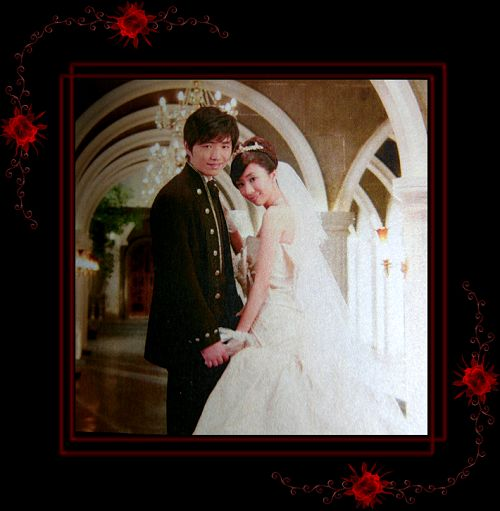

# 大家都需要happy ending！

转了半个南京城，迟到半小时到婚礼现场，还好，没开始呢。  
  
提前一个小时出门，路上那个堵啊，敢情这路上的车都跟我一样朝婚礼现场开的吗？走哪儿堵哪儿。到了酒店光找地方停车就找了20多分钟，顺便把车位上的车都扫了一遍，好车如云啊。  
  
婚礼前半段是我喜欢的，看过放照片的婚礼，但这次做的很细腻、精致，连同双方父母的结婚照也有，那一刻是不是每个人的心中都会产生温暖的感觉？婚礼就这样在一片不经意的爱意中展开了。后半段感觉处于一片乱战之中，500多号人，开始相互窜位子敬酒，好象集团开年会似的。没有酒精热身，我们这桌真是安静的可以。特别让人难忘的是新娘子的妈妈，之前曾参加过公司的集体旅行，气质温婉，容貌娇好，尤其在她这个年龄段有如此仪容的女士“很”不多见。美丽的女人，无论什么年纪，一样让人驻足，赏心悦目，她的美丽不是建立在堆积的脂粉和华服上，你看不到一点中年女人的世俗气息，脸上写满温和的自信、满足和优雅，宛如一朵白色的百合花绽放在人群中！  
  
这场隆重的婚礼让我联想起《SEX AND CITY》电影版里Carrie策划邀请200人的婚礼，吓走了MR.BIG。（以下来自豆瓣的电影评论）Carrie和他之间数不清多少次分分和和，伤心都是自己找来虐待自己，雷同的是，作为观众的我们在现实生活中不也一样对爱你的人残忍对你爱的人甘愿低到尘埃里去吗？ 如果心中有那个值得你在某个时刻可以为她穿越城市的朋友，如果在新年来临的那一秒，心中有一个深深爱着的人，就是幸福的。  
　　   
如果，如果必须选择，一个婚礼上失踪的男人和一个偶尔出轨的男人，哪一种更容易忘记。  
如果，如果重来一次，一段失而复得的感情和一段遗憾错过的爱恋，哪一个更让你难以忘怀？   
  
真爱就像UFO，都听说过，谁也没有看到。   
友情呢，也许回首时，才会发现，真水无香。  
  
再回头转向这对新人，我想用可爱和默契来形容。婚礼在生活中是否代表着某个标点符号？但不确定究竟是逗号？句号？还是感叹号？无论是哪一个，都希望能把最好的祝福送给他们！  
  

---

## 评论（5）

**[Catherine](http://forucy.blogcn.com)** · 2008-12-07

500多号人啊?  
偶能忍受的大场面人数不能超过五十人,超过的话,偶就开始犯困犯晕犯病…  
还有邻居结婚请了六十桌的…估计和其他人比起来还是小意思的.

偶不要啦…太恐怖勒…….

**itsmin** · 2008-12-08

到最后是不是happy ending, 不是说不重要，只是无法猜想。真诚地送上祝福就是了。

**Michelle** · 2008-12-09

爱情的宣言在心中就够了。爱情的宣传散布全世界，又有几个人去相信，去在乎。觉得那些句号似的的结婚形式无非是精神和物质上的超重砝码。

**Jennifer** · 2008-12-09

wondering,  
let’s wait and see

**okdata** · 2008-12-09

哈哈，UFO。。。经典  
好象集团开年会。。。好玩  
中年女人的世俗。。。男人也一样，不过隐藏得深  
失而复得的感情 > 遗憾错过的爱恋，因为你正在享受它  
失踪的男人 > 出轨的男人 至少前者懂得搞不定就不负这个责  
世俗说，幸福就是家庭和睦、人丁齐全、鸡鸭满堂。。。  
影评说：新年来临的那一秒，心中有一个深深爱着的人，就是幸福的。。。  
Anyway, 祝福大家

